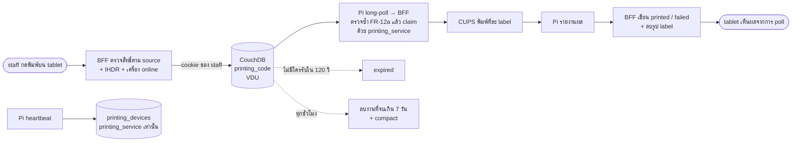
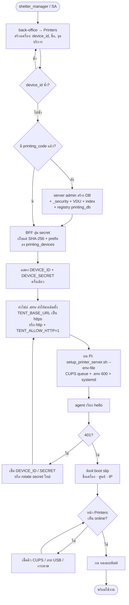
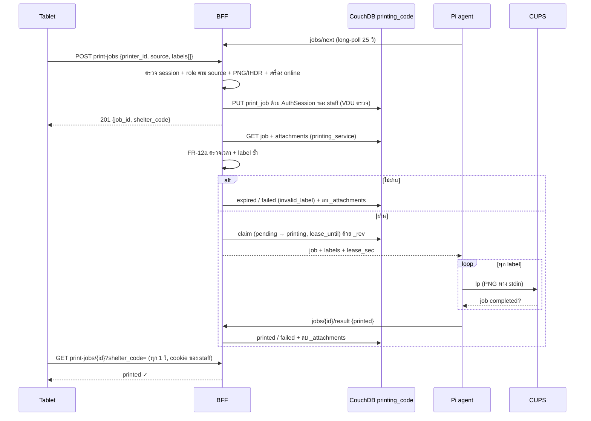
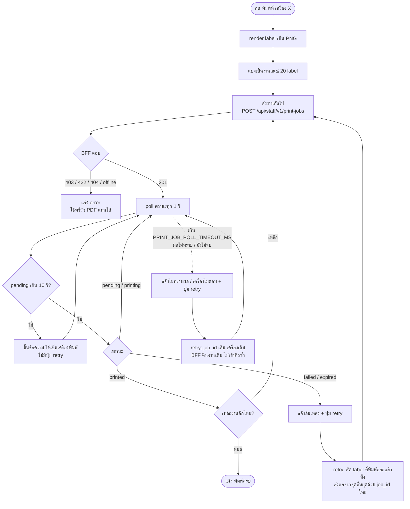
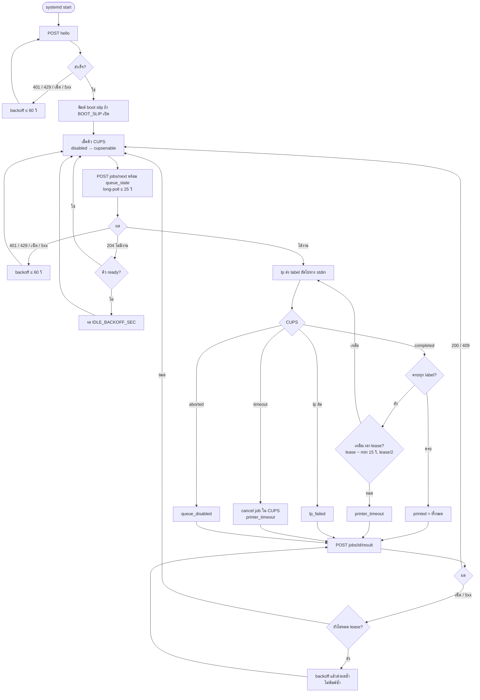
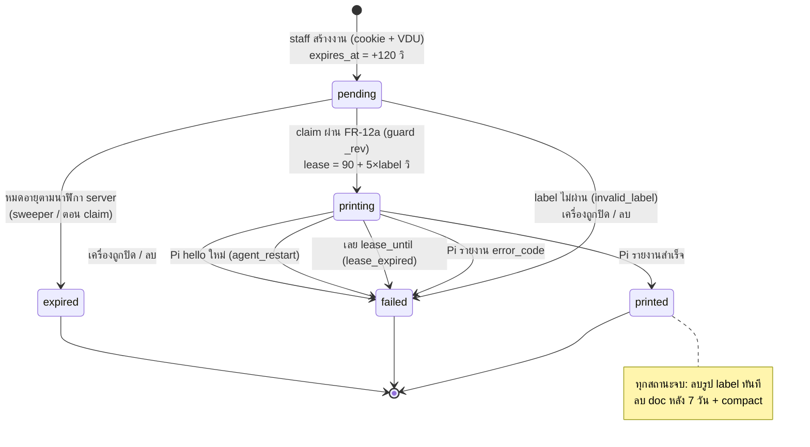
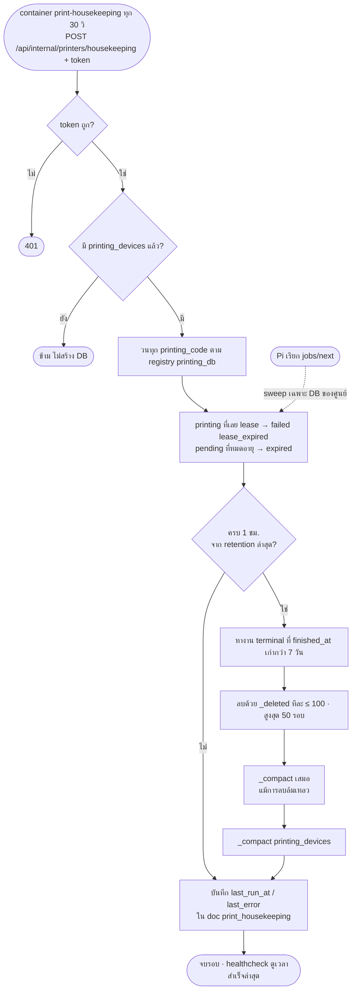

# CR-222 — Station print server

> **สรุป (TL;DR)**
>
> - **เปลี่ยนอะไร:** staff กด "พิมพ์ทั้งครอบครัว" / "พิมพ์ที่ <เครื่อง>" แล้ว label QR 80×60 mm ออกที่เครื่องพิมพ์ของจุดนั้นทันที ไม่มี print dialog ไม่ต้องลง driver บน tablet
> - **ทำงานยังไง:** tablet ส่ง PNG ไปที่ staff BFF → BFF ตรวจแล้ว **เขียนงานด้วย cookie ของ staff** ลง DB ของศูนย์ **`printing_{shelter_code}`** (VDU บังคับ) → Pi agent (`printer/`) long-poll device BFF → BFF claim งานด้วย service user **`printing_service`** และตรวจ label ซ้ำก่อนส่ง → พิมพ์ผ่าน CUPS → รายงานผล
> - **build:** DB `printing_devices` (เครื่อง, service user เท่านั้น) + `printing_{shelter_code}` (งาน, staff ของศูนย์ + VDU) · route 4 กลุ่ม (Pi / staff / back-office / internal) · container `print-housekeeping` · feature `printers` · Pi agent · สิทธิ์จัดการเครื่อง = SA + `shelter_manager`
> - **ข้อจำกัด:** WAN ล่ม → พิมพ์ผ่านเครื่องพิมพ์ไม่ได้ ใช้พรีวิว PDF เดิมแทน · staff ในศูนย์เดียวกันอ่านงานพิมพ์ของกันได้ผ่าน `/couch` (FR-31)
> - **ก่อน merge PR โค้ด:** O-5 (`cupsenable`) ได้รับการอนุมัติ waive โดย Project Owner (2026-11-05) ให้เลื่อนการทดสอบ granular privileges / sudoers ไปเป็นงานติดตามหลัง merge (as-built ปลอดภัยแบบ fail-closed) · O-10 ทดสอบแล้ว 2026-11-01 (VDU เห็น `length` → FR-51 บังคับ ≤ 64 KB)
> - **ทดสอบ local 2026-11-04:** Pi + XP-365B พิมพ์ได้ end-to-end · O-5 เลื่อนเป็น post-merge operation

ที่มาและทางเลือกที่ตัดทิ้ง: §Why · สถานะ build: implement ตามฉบับนี้บน branch `poc-print-server` (PR โค้ดแยกจาก PR นี้) — ยังไม่ merge

> **ส่วนที่ปรับ 2026-10-29 — ทีม kiosk เสนอตาม review PR #932 · Project Owner ตัดสินข้อเปิดแล้ว 2026-10-31 (review รอบ 3) · approved**
>
> - **แยก DB (review รอบ 1 ข้อ 6 + รอบ 2):** `print_device` ย้ายไป `printing_devices` · คิวงานแยกเป็น `printing_{shelter_code}` ต่อศูนย์ — heartbeat ไม่ปลุก `_changes` ของงาน และ feed ของ Pi ถูกปลุกเฉพาะงานของศูนย์ตัวเอง (FR-1..4, FR-50)
> - **credential (รอบ 2):** งานที่ staff สั่ง (สร้างงาน, ดูสถานะ, test-print) เขียน/อ่านด้วย cookie ของ staff · งานของ Pi, housekeeping, จัดการเครื่อง ใช้ service user `printing_service` (admin เฉพาะ DB printing) · server admin ใช้เฉพาะตอน provision DB (FR-2, FR-2a)
> - **จำกัดสองชั้น:** VDU กันตอนเขียน (FR-51) + BFF ตรวจ label/เวลาซ้ำตอน claim ด้วยนาฬิกา server (FR-12a) — เพราะ staff เขียน DB ตรงผ่าน `/couch` ได้โดยไม่ผ่าน BFF และ VDU อ่าน byte ของ PNG ไม่ได้
> - **PNG (รอบ 1 ข้อ 1):** ตรวจ IHDR ให้ตรงขนาด label เป๊ะ ทั้งที่ BFF ตอนสร้างและตอน claim (FR-29, FR-12a)
> - **สิทธิ์สั่งพิมพ์ตาม `source` (รอบ 1 ข้อ 8, O-2):** FR-29a
> - **housekeeping (รอบ 1 ข้อ 4):** ย้ายจาก timer ใน `hooks.server.ts` ไป container `print-housekeeping` + `last_run_at` + healthcheck (FR-17, FR-17a)
> - **Pi:** `TENT_BASE_URL` เป็น `https://` ยกเว้น loopback หรือเปิด `TENT_ALLOW_HTTP=1` สำหรับ edge ที่ไม่มี HTTPS (รอบ 1 ข้อ 2, O-9 · ปรับ 2026-11-06) · nginx `limit_conn` ≤ 2 ต่อคู่ `x-device-id` + IP ของ client (ข้อ 7) · สิทธิ์ `cupsenable` ต้องทดสอบบน Pi (ข้อ 12, O-5) · เครื่องพิมพ์ในตู้ kiosk มี 2 credential แยก (ข้อ 14)
> - **เอกสาร:** §Impact รูป label ค้างได้ ~1 ชม. หลังงานจบ (ข้อ 9) · FR-31 อ่อนลง · เพิ่ม FR-49 (`_changes` เส้นเดียวต่อ process) · Acceptance load test · §Compromise

---

## Requirements

### Data — DB `printing_devices` + `printing_{shelter_code}` (schema.md §10)

- **FR-1** — DB `printing_devices` (เครื่องทั้งระบบ) และ `printing_{shelter_code}` (คิวงานต่อศูนย์, ชื่อ DB ใช้ `shelter_code` ตัวเล็กแบบเดียวกับ `shelter_{shelter_code}`) อยู่ที่ central เท่านั้น: ไม่ replicate ไป edge, worker ไม่ sync เข้า MongoDB. _(ปรับ 2026-10-29: เดิม DB `printing` เดียว)_
- **FR-2** — `_security`: _(ปรับ 2026-10-29)_
  - `printing_devices`: `admins.names = ["printing_service"]`, `members.names = ["printing_service"]` — browser และ staff อ่าน/เขียนไม่ได้
  - `printing_{code}`: `admins.names = ["printing_service"]`, `members.roles = ["shelter:{CODE}", "system_admin"]`, `members.names = ["printing_service"]` + VDU (FR-51)
- **FR-2a** — credential ที่ BFF ใช้กับ CouchDB: _(ใหม่ 2026-10-29)_

  | งาน                                                                                                           | credential                                                                  |
  | ------------------------------------------------------------------------------------------------------------- | --------------------------------------------------------------------------- |
  | staff สร้างงาน (`POST /api/staff/v1/print-jobs`) · ดูสถานะ (`GET /api/staff/v1/print-jobs/{id}`) · test-print | `AuthSession` ของผู้เรียก (helper เขียนในนามของ user ใหม่ใน `$lib/server/`) |
  | tablet ดูรายการเครื่อง (`GET /api/staff/v1/printers`)                                                         | `printing_service` (เครื่องอยู่ `printing_devices` ที่ staff อ่านไม่ได้)    |
  | Pi: `hello` / `jobs/next` / `result` / heartbeat · claim                                                      | `printing_service`                                                          |
  | housekeeping: sweep / ลบงานเก่า / `_compact`                                                                  | `printing_service`                                                          |
  | สร้าง / แก้ / rotate secret / ลบเครื่อง                                                                       | `printing_service`                                                          |
  | สร้าง DB + `_security` + VDU + index                                                                          | server admin (`$lib/server/couch-admin.ts`) เฉพาะตอน provision (FR-4)       |

  `printing_service` เป็น CouchDB user ไม่มี role, เป็น admin เฉพาะ DB ใน FR-2 — ถ้าโค้ด printer ถูกเจาะก็แตะ DB อื่นไม่ได้; credential อยู่ใน env ฝั่ง server เท่านั้น

  _(เพิ่ม 2026-10-31 — ทีมเสนอ)_
  - env `COUCHDB_PRINTING_SERVICE_URL` (`http://printing_service:<pw>@couchdb:5984`) — ห้ามขึ้นต้น `PUBLIC_` · user ถูกสร้างแบบ idempotent โดย `pnpm seed` และ `pnpm redeploy:access` แบบเดียวกับ `public_writer`
  - ไม่ได้ตั้ง env นอก dev → route ของ printer ตอบ 503 `DEPENDENCY_UNAVAILABLE` (fail closed) **ห้าม** fallback ไป server admin · dev เท่านั้นที่ fallback ได้พร้อม warn
  - server admin ใช้ได้ที่ module provision เดียว (สร้าง / ลบ DB ตาม FR-4) · route ของ printer ห้าม import `$lib/server/couch-admin` (บังคับด้วย ESLint)
  - ชื่อ DB สร้างจาก `shelter_code` ที่ผ่าน `^[A-Z0-9]+$` เท่านั้น

- **FR-3** — `_revs_limit`: `printing_devices` = 10 (heartbeat สร้าง ~4,320 revision ต่อเครื่องต่อวัน) · `printing_{code}` = 100. _(ปรับ 2026-10-29)_
- **FR-4** — provision แบบ idempotent ด้วย server admin: _(ปรับ 2026-10-29)_
  - `printing_devices` + `_security` + index — ครั้งแรกที่ route ใด ๆ ใช้
  - `printing_{code}` + `_security` + design doc VDU + index — ตอนสร้างเครื่องแรกของศูนย์ (lazy) แล้วเขียน `printing_db:{code}` ลง `printing_devices` เป็น registry ให้ housekeeping วนครบทุก DB แม้เครื่องถูกลบหมดแล้ว
  - ปิดศูนย์ (`closed` หรือ `cancelled`) — ทำใน checklist ปิดศูนย์เดิม (`data-model.md` §1) **ทันที** ไม่รอ DB ว่าง ตามลำดับ: (1) ตั้งเครื่องทุกเครื่องของศูนย์เป็น `inactive` (FR-15 → งานค้างเป็น `failed (printer_inactive)`) → (2) ลบ `printing_{code}` → (3) ลบ `printing_db:{code}` ออกจาก `printing_devices` (O-11) · idempotent (รันซ้ำได้) · จนกว่าจะมี flow ปิดศูนย์ในระบบ ops รัน script `close-shelter-printing` (dry-run เป็นค่าเริ่มต้น) ตาม checklist _(script: ทีมเสนอ 2026-10-31)_
  - housekeeping ไม่สร้าง DB ให้ server ที่ยังไม่มีเครื่องพิมพ์
  - staff `POST /print-jobs` เจอ `printing_{code}` หาย (404) → BFF **อ่านเครื่องใหม่** แล้ว reprovision + PUT ซ้ำเฉพาะเมื่อเครื่องยัง `active` · ไม่ active → 404 `PRINTER_NOT_FOUND` ไม่สร้าง DB ของศูนย์ที่ปิดแล้วกลับมา (O-11) _(แก้ตาม review ของ team lead 2026-11-05, PR โค้ด ข้อ 3)_
- **FR-5** — `print_device:{device_id}` (ใน `printing_devices`): `device_id` ตรง `^[a-z0-9][a-z0-9-]{2,62}$`, `name` 1–80 ตัว, ผูก `shelter_code`, `station` (nullable). _(ถอด `host_kind` และ `kiosk_device_id` ออก 2026-11-05 — ใช้เป็นเครื่องพิมพ์ standalone)_
- **FR-5a** — ~~เครื่องพิมพ์ในตู้ kiosk ผูกกับ scanner device ผ่าน `kiosk_device_id`~~ _(ตัดออก 2026-11-05 — ใช้เครื่องพิมพ์ standalone ไม่จับคู่กับตู้ · ถ้าวันหลังติดเครื่องพิมพ์ในตู้ ตู้นั้นยังมี credential แยก scanner / print device ตามปกติ)_
- **FR-6** — `print_device` เก็บ **แค่** `secret_hash` (SHA-256 hex) และ `secret_prefix` (16 ตัวแรก) — ห้ามเก็บ secret ตัวจริงในที่ใดเลย.
- **FR-7** — `print_job:{ulid}` (ใน `printing_{code}`) แนบ label เป็น `_attachments` `label-NNN.png` (`image/png`) ระหว่าง `pending`/`printing` เท่านั้น; มี `shelter_code`, `printer_id`, `source`, `label_count`, `created_by`, `created_at`, `expires_at`.

### สถานะงานพิมพ์

- **FR-8** — สถานะ: `pending` → `printing` → `printed` | `failed`; `pending` → `expired` | `failed`. `printed`/`failed`/`expired` เป็น terminal ไม่ย้อนกลับ.
- **FR-9** — ทุก write ที่ไปสถานะ terminal ตั้ง `finished_at` และ **ไม่มี `_attachments`** ใน write เดียวกัน (label ถูกลบทันทีที่งานจบ).
- **FR-10** — สร้างงานผ่าน BFF: `created_at` = นาฬิกา server, `expires_at = created_at + 120 วิ` (`JOB_TTL_SEC`); ไม่มีใครรับทันเวลา → `expired`.
- **FR-11** — claim: เลือกงาน `pending` ที่เก่าสุดของเครื่องนั้น ผ่าน FR-12a แล้ว PUT เป็น `printing` พร้อม `claimed_at`, `lease_until = now + lease_sec` โดย `lease_sec = 90 + 5 × label_count`; ชน `_rev` → ข้ามไปงานถัดไป (กันพิมพ์ซ้ำเมื่อมี agent หลายตัว).
- **FR-12** — งานที่หมดอายุตาม FR-12a ระหว่าง claim → `expired` ทันที ไม่ส่งให้ Pi.
- **FR-12a** — ตรวจซ้ำตอน claim (ด้วย `printing_service` + นาฬิกา server) เพราะงานอาจถูกเขียนตรงเข้า DB โดยไม่ผ่าน BFF: _(ใหม่ 2026-10-29)_
  - **เวลา:** ไม่เชื่อ `created_at`/`expires_at` ที่มากับ doc — `created_at` อยู่ในอนาคตเกิน 5 วิ หรืออายุจริง `min(expires_at, created_at + 120 วิ)` เลยแล้ว → `expired`
  - **label:** จำนวน attachment = `label_count` (1–20) · ทุกรูปมี PNG magic bytes, ≤ 64 KB, IHDR width/height = `kioskLabelDots()` และ (bit depth, color type) อยู่ใน whitelist ของ FR-29 — ไม่ผ่าน → `failed (invalid_label)` ไม่ส่งรูปให้ Pi
  - `printer_id` ต้องเป็นเครื่องที่ poll อยู่ และ `shelter_code` ของเครื่องต้องตรงกับ DB
- **FR-13** — `error_code` ฝั่ง agent: `printer_timeout` · `queue_disabled` · `lp_failed`; ฝั่ง server: `agent_restart` · `lease_expired` · `printer_inactive` · `printer_deleted` · `invalid_label` _(เพิ่ม 2026-10-29)_.
- **FR-14** — Pi เรียก `hello` → งาน `printing` ทั้งหมดของเครื่องนั้นเป็น `failed (agent_restart)` (ความเสี่ยง DoS ยอมรับใน §Compromise ข้อ 3).
- **FR-15** — ปิดเครื่อง (`inactive`) → เขียนเครื่องเป็น inactive ก่อน แล้ว fail งาน `pending`/`printing` ของเครื่องเป็น `printer_inactive`; ลบเครื่อง → fail เป็น `printer_deleted` แล้วจึงลบ doc.
- **FR-16** — ทุกการตัดสินเรื่องเวลา (TTL, lease, online) ใช้นาฬิกา server (Pi ไม่มี RTC, tablet / doc ที่เขียนตรงเชื่อไม่ได้).

### Housekeeping / retention (PDPA)

- **FR-17** — container `print-housekeeping` (image เดียวกับ frontend แบบ `import-worker`) เรียก `POST /api/internal/printers/housekeeping` ทุก 30 วิ (`SWEEP_INTERVAL_SEC`) ด้วย `Authorization: Bearer <PRINT_HOUSEKEEPING_TOKEN>` (env ฝั่ง server เท่านั้น) · BFF **ไม่ตั้ง timer เอง** (`hooks.server.ts` ไม่มี `init` ของ printer) เพื่อไม่ให้รันซ้ำทุก process / replica · route วนทุก `printing_{code}` ตาม registry `printing_db:*` (FR-4): `printing` ที่เลย `lease_until` → `failed (lease_expired)`; `pending` ที่หมดอายุตาม FR-12a → `expired`. sweep เฉพาะ DB ของเครื่องตอน Pi poll ยังคงไว้. _(ปรับ 2026-10-29)_
- **FR-17a** — บันทึก `last_run_at` / `last_retention_at` / `last_error` ลง doc `print_housekeeping` ใน `printing_devices` · container healthcheck = unhealthy เมื่อเรียกสำเร็จครั้งล่าสุดเกิน 2 นาที (กัน purge หยุดเงียบ). _(ใหม่ 2026-10-29)_
- **FR-18** — retention ทุกชั่วโมง ต่อ `printing_{code}`: ลบงาน terminal ที่ `finished_at` เก่ากว่า **7 วัน** (O-1) ด้วย `printing_service` ผ่าน `_bulk_docs` (`_deleted: true`) ทีละ ≤ 100 doc, สูงสุด 50 รอบต่อครั้ง · ไม่ใช้ `_purge` เพราะ CouchDB 3.5 ต้องใช้ server admin · tombstone เหลือแค่ `_id` / `_rev` ไม่มีข้อมูลบุคคล. _(ปรับ 2026-11-01 — ทีมเสนอ)_
- **FR-19** — หลังลบต้องสั่ง `_compact` **เสมอ** (แม้ไม่มีอะไรถูกลบหรือการลบล้มเหลว) เพราะ revision ก่อน terminal write ยังมีรูป label · compact `printing_devices` ทุกชั่วโมงด้วย (revision ของ heartbeat). _(ปรับ 2026-10-29)_
- **FR-20** — sweep / retention ที่ล้มเหลวไม่ทำให้ request ของ Pi ล้ม; รอบถัดไปลองใหม่; DB หนึ่งล้มไม่หยุด DB อื่น.

### API — Pi (`/api/v1/printer/*`, header `x-device-id` + `x-device-secret`)

- **FR-21** — `POST /hello` body `{agent_version, queue_state, local_ips[]}` → ทำ FR-14, บันทึก heartbeat (บังคับเขียน), ตอบ `{device: {device_id, name, shelter_code}, server_time, config: {wait_sec: 25, lease_sec}}` (`lease_sec` = lease ของงาน 1 label ใช้เป็นค่า fallback) · `agent_version` ≤ 64 ตัว เกิน → 422 _(เพิ่ม 2026-10-31 — ทีมเสนอ)_.
- **FR-22** — `POST /jobs/next` body `{queue_state}` → heartbeat (throttle) + sweep DB ของศูนย์ถ้าถึงรอบ; `queue_state ≠ ready` → 204 ทันที; ไม่งั้น long-poll ≤ 25 วิ ผ่าน `_changes` ของ `printing_{code}` แล้วตอบ `{job: {id, label_count, lease_sec, lease_until}, labels[]}` หรือ 204.
- **FR-23** — `POST /jobs/{id}/result` body `{printed: int≥0, error_code?}` → `printed` ถ้าไม่มี `error_code` ไม่งั้น `failed`; งานต้องเป็น `printing` ของเครื่องนี้ ไม่งั้น 409 `JOB_CONFLICT`; body ผิด → 422.
- **FR-24** — heartbeat เขียน `last_seen_at`/`queue_state`/`agent_version`/`local_ips` ลง `printing_devices` อย่างมากครั้งละ 20 วิ เว้นแต่ค่าเปลี่ยน; ชน `_rev` → ทิ้ง (poll ถัดไปเขียนใหม่). `local_ips` เก็บเฉพาะ IPv4/IPv6 ที่ถูกต้อง ≤ 8 ค่า. heartbeat **ไม่แตะ** `printing_{code}`.
- **FR-25** — auth ไม่ผ่าน (ไม่มีเครื่อง / secret ผิด / `inactive`) → 401 `DEVICE_AUTH_FAILED` แบบเดียวกันทุกกรณี; DB ใช้ไม่ได้ → 503 `DEPENDENCY_UNAVAILABLE`; response ไม่มีรายละเอียด upstream หรือ secret.
- **FR-26** — เทียบ secret ด้วย SHA-256 + `timingSafeEqual` ผ่าน helper กลาง `$lib/server/device-auth/` ที่ใช้ร่วมกับ scanner (ไม่เปลี่ยนพฤติกรรม). _(ปรับ 2026-10-29)_
- **FR-27** — ทุก response ของ route printer มี `cache-control: no-store`.
- **FR-27a** — nginx จำกัด connection พร้อมกัน ≤ 2 ต่อคู่ `x-device-id` + IP ของ client (`$binary_remote_addr`) ที่ `/api/v1/printer/` (`limit_conn`, ตามแนว CR-188) เกิน → 429 · agent ถือ 429 เป็น error แล้ว backoff (FR-41) · ไม่ใช้ `x-device-id` อย่างเดียวเป็น key เพราะ device id ไม่ใช่ความลับ (`GET /api/staff/v1/printers` คืนให้ทุก tablet) ใครรู้ id ก็จอง connection จน Pi ตัวจริงโดน 429 ได้ · ต้องตั้ง `real_ip_*` ให้ nginx เห็น IP จริงเมื่ออยู่หลัง proxy. _(ใหม่ 2026-10-29, ปรับ 2026-11-02)_

### API — tablet (`/api/staff/v1/*`, cookie `_session`)

- **FR-28** — `GET /printers?shelter_code=` → เครื่อง `active` ของศูนย์ เรียงตามชื่อ `{id, name, station, online, queue_state, last_seen_at}` — ไม่มี secret/hash/`local_ips`; ต้องมี scope ศูนย์นั้นหรือเป็น SA.
- **FR-29** — `POST /print-jobs` body `{printer_id, source: walk_in|evacuee_qr, labels[]}`: labels 1–20 รูป, แต่ละรูป base64 ถูกต้อง + PNG magic bytes + ≤ 64 KB + **IHDR width/height = `kioskLabelDots()` (639×479) และ (bit depth, color type) ∈ {(8,6), (8,2), (8,0), (1,0)}** (whitelist ทีมเสนอ 2026-11-01 — ยืนยันกับ browser ของ tablet จริงก่อน merge PR โค้ด), รวม ≤ 1 MB (ผิด → 422 `INVALID_LABELS`); ผู้เรียกต้องผ่าน FR-29a สำหรับศูนย์**ของเครื่องพิมพ์**; เครื่องไม่มี/inactive → 404; offline → ปฏิเสธ ไม่เข้าคิว; ผ่านแล้ว PUT ลง `printing_{code}` ด้วย cookie ของผู้เรียก (FR-2a); สำเร็จ → 201 `{job_id, shelter_code, expires_at}`. _(ปรับ 2026-10-29)_
  - **idempotent create** _(แก้ตาม review ของ team lead 2026-11-05, PR โค้ด ข้อ 5)_: body รับ `job_id` (optional) = ULID เปล่า `^[0-9A-HJKMNP-TV-Z]{26}$` (ผิดรูป → 422 `INVALID_LABELS`) · `_id` = `print_job:{job_id}` · ไม่ส่ง → server ออกให้ (test-print / client เก่า) · tablet ออก `job_id` ต่อ chunk และใช้ id เดิมเมื่อ retry หลัง POST ไม่รู้ผล (error / Cancel / timeout) · PUT เจอ 409 → BFF อ่านเอกสารเดิมด้วย cookie ของผู้เรียก: `created_by`, `shelter_code`, `printer_id`, `source`, `label_count` ตรงทั้งหมด → 201 พร้อม `expires_at` ของงานเดิม (ไม่เข้าคิวซ้ำ) · ไม่ตรง → 409 `JOB_ID_CONFLICT` (tablet ออก id ใหม่) · อ่านไม่ได้ → 503 · เครื่อง offline แต่ `job_id` นี้มีงานของผู้เรียกที่ตรงทั้งห้าข้ออยู่แล้ว → ตอบงานเดิม (201) ไม่ปฏิเสธ เพื่อให้ tablet ตามผลงานเดิมได้; ไม่มีงาน → 409 `PRINTER_OFFLINE` ตามเดิม _(แก้ตาม review ของ team lead 2026-11-06, PR #1182 รอบ 4 S2)_ · หลังงาน**จบ**เป็น `failed` / `expired` label ที่เหลือส่งด้วย id ใหม่ · ผลไม่ทราบ / ครบเวลา (FR-47) ยังใช้ id เดิม
  - tablet ยกเลิก POST (AbortSignal) เมื่อกด Cancel / ออกจากหน้า หรือครบ `PRINT_JOB_CREATE_TIMEOUT_MS` = 15 วิ → แสดง "ส่งไม่สำเร็จ" + retry ด้วย `job_id` เดิม
- **FR-29a** — สิทธิ์สั่งพิมพ์ตาม `source` (บังคับทั้งที่ BFF และ VDU): _(ใหม่ 2026-10-29, แทน O-2 เดิม)_

  | `source`     | role ใน `userCtx.roles` ที่ต้องมีอย่างน้อยหนึ่งตัว                                           |
  | ------------ | -------------------------------------------------------------------------------------------- |
  | `walk_in`    | `{CODE}:registration_staff` · `{CODE}:shelter_manager` · `system_admin`                      |
  | `evacuee_qr` | `{CODE}:registration_staff` · `{CODE}:shelter_manager` · `system_admin`                      |
  | `test`       | `{CODE}:shelter_manager` · `system_admin` (ผ่าน back-office test-print เท่านั้น)              |

  - `{CODE}` = `shelter_code` **ตัวใหญ่**ของเครื่อง / ของ DB (`printing_sh001` → `SH001`) · role ของศูนย์อื่น (เช่น `SH002:registration_staff`) ไม่นับ · ไม่ใช่ `system_admin` ต้องมี `shelter:{CODE}` ด้วย (ประตู `_security`, FR-2)
  - VDU เช็ค string เหล่านี้ตรงๆ (เรียก `hasStaffCapability` ไม่ได้) · BFF ใช้ชุดเดียวกัน — ตรงกับ guard `requireEvacueeRegistration` ของหน้าที่ปุ่มพิมพ์อยู่ (walk-in, โปรไฟล์ผู้อพยพ)
  - role คือของ staff ที่สั่งพิมพ์ ไม่ใช่ของเครื่อง
  - ไม่รับ role แบบ flat ที่ไม่มี prefix ศูนย์ (เช่น `registration_staff` เฉยๆ) ทั้งที่ BFF และ VDU ให้ตรงกัน — ก่อน deploy ต้องย้าย user ที่ยังเป็น flat (ถ้ามี) _(เพิ่ม 2026-10-31 — ทีมเสนอ)_

- **FR-30** — "online" = `active` + `queue_state = ready` + `last_seen_at` ภายใน 90 วิ ตามนาฬิกา server.
- **FR-31** — `GET /print-jobs/{id}?shelter_code=` → `{status, printed, label_count, error_code}` อ่านจาก `printing_{code}` ด้วย cookie ของผู้เรียก; BFF ตอบเฉพาะคนที่สร้างงาน (`created_by`) หรือ SA. **ข้อจำกัด:** CouchDB กันการอ่านระดับ doc ไม่ได้ — staff ที่มี role `shelter:{CODE}` อ่านงานทุกงานของศูนย์ (รวมรูป label ระหว่าง `pending`/`printing`) ได้ตรงผ่าน `/couch` ระดับเปิดเผยเท่ากับ `shelter_{code}` ที่อ่านได้อยู่แล้ว. _(ปรับ 2026-10-29)_

### API — back-office (`/api/back-office/printers*`)

- **FR-32** — `GET` รายการเครื่องใน scope + `online` + `local_ips` + `secret_prefix` + งานล่าสุด 1 งาน · `POST` สร้างเครื่อง (provision `printing_{code}` ถ้ายังไม่มี) คืน secret (`sk_print_` + 64 hex) **ครั้งเดียว** · `PATCH /{id}` แก้ `name`/`station`/`status` _(ปรับ 2026-11-05: ถอด `kiosk_device_id`)_ · `POST /{id}/rotate-secret` คืน secret ใหม่ครั้งเดียว · `POST /{id}/test-print` (label ทดสอบในตัว 639×479 1-bit ไม่มีข้อมูลคน, `source: test`, เขียนด้วย cookie ของผู้เรียก) · `DELETE /{id}`. · ศูนย์ไม่มีในทะเบียน หรือ `closed` / `cancelled` → `POST` สร้างเครื่อง และ `PATCH` ที่ตั้ง `status: active` ตอบ **422 `SHELTER_CLOSED`** (ตรวจหลัง RBAC) ไม่ provision `printing_{code}` กลับมา (O-11) — status ตาม convention `SHELTER_CLOSED` เดิมของบริจาค _(แก้ตาม review ของ team lead 2026-11-06, PR #1182 รอบ 3 W3)_
- **FR-33** — ทุก route ต้องเป็น SA หรือ `shelter_manager` ของศูนย์ของเครื่อง (`PRINTER_MANAGER_CAPABILITIES`, O-3); `kiosk_staff` จัดการไม่ได้.
- **FR-34** — แก้ device doc แบบ read-modify-write retry ≤ 4 ครั้งเมื่อชน `_rev` (heartbeat เขียนทับบ่อย) โดยคงค่า heartbeat ล่าสุด.

### API — internal

- **FR-34a** — `POST /api/internal/printers/housekeeping` รับเฉพาะ `Authorization: Bearer <PRINT_HOUSEKEEPING_TOKEN>` (เทียบแบบ constant-time) ไม่มี/ผิด → 401 · ไม่เปิดผ่าน nginx ไปข้างนอก (เรียกใน network ของ compose) · ตอบ `{swept, purged, compacted, errors}`. _(ใหม่ 2026-10-29)_

### Pi agent (`printer/`)

- **FR-35** — `printed` นับเมื่อ CUPS รายงาน job `completed` (อ่าน `job-state` ผ่าน IPP ไม่ใช่แค่ `lp` exit 0); ส่งภาพทาง stdin, job title `tent-print-job`, `-o ppi=<PRINT_PPI>`; log ไม่มี secret หรือ byte ของ label.
- **FR-36** — config จาก env: `TENT_BASE_URL` (บังคับ `https://` เป็นค่าเริ่มต้น, ยอม `http://` ไป loopback สำหรับ dev · ไป host อื่น (IP ใน LAN / domain ที่ไม่มี HTTPS) ได้เมื่อตั้ง `TENT_ALLOW_HTTP=1` และ agent log เตือนตอน start ว่า secret วิ่งแบบไม่เข้ารหัส), `TENT_ALLOW_HTTP` (0), `DEVICE_ID`, `DEVICE_SECRET`, `PRINTER_NAME` (default `tent_xprinter`), `PRINT_PPI` (203), `PRINT_JOB_TIMEOUT_SEC` (30), `IDLE_BACKOFF_SEC` (5), `ERROR_BACKOFF_MAX_SEC` (60), `BOOT_SLIP` (true). _(ปรับ 2026-10-29, 2026-11-06)_
- **FR-37** — เริ่มทำงาน: `hello` (retry + backoff จนสำเร็จ) → พิมพ์ boot slip (ชื่อเครื่อง, ศูนย์, IP, version) ถ้า `BOOT_SLIP` เปิด.
- **FR-38** — ทุกรอบ poll เรียก `cupsenable` ถ้าคิวถูก disable แล้วรายงาน `queue_state`; log เมื่อสถานะคิวเปลี่ยน.
- **FR-39** — ใช้ `lease_sec` ของงาน (ไม่มี → ใช้ของ `hello`); หยุดส่ง label ถัดไปที่ `claimed_at + lease − min(15 วิ, lease/2)` แล้วรายงาน `printer_timeout`; label ที่ CUPS ค้างถูก cancel.
- **FR-40** — retry **เฉพาะการรายงานผล** (ไม่พิมพ์ซ้ำ) ด้วย backoff จนถึง `claimed_at + lease`; 409 → เลิก.
- **FR-41** — 401 / 429 / network / 5xx / response อ่านไม่ได้ → exponential backoff สูงสุด `ERROR_BACKOFF_MAX_SEC`.
- **FR-42** — ติดตั้งด้วย `setup_printer_server.sh --env-file`: `.env` mode 600 owner `tent-printer`; systemd `tent-printer` รันเป็น user `tent-printer`, `NoNewPrivileges`, `ProtectSystem=strict`, `ProtectHome`, `PrivateTmp`, `Restart=always` · สิทธิ์ `cupsenable` ให้แคบที่สุดที่ทดสอบผ่าน: group `lp` ถ้าพอ ไม่งั้น polkit / sudoers ที่อนุญาตเฉพาะ `cupsenable <queue นี้>` — **ไม่ใส่ `tent-printer` ใน group `lpadmin`** (O-5). _(ปรับ 2026-10-29)_

### UI

- **FR-43** — `PrintLabelsButton` (feature `printers`) ใช้ใน walk-in "พิมพ์ทั้งครอบครัว" (`family-batch-print.svelte`, `source: walk_in`) และหน้าโปรไฟล์ผู้อพยพ (`evacuee-qr-modal.svelte`, `source: evacuee_qr`); ซ่อนปุ่มเมื่อผู้ใช้ไม่ผ่าน FR-29a. _(แก้ตาม review ของ team lead 2026-11-06, PR #1182 รอบ 3 W1/W2)_ หน้า family batch มีปุ่มพิมพ์**ชุดเดียว** ("พิมพ์ทั้งครอบครัว") — การ์ดของสมาชิกแต่ละคนซ่อนปุ่มรายคน (`printable={false}`) เพื่อให้หนึ่ง label มี print state เดียว · ระหว่างพิมพ์ **และระหว่างที่ยังมีงานผลไม่ทราบรอตาม** (FR-47: ผลไม่ทราบ / ครบเวลา / ยกเลิกระหว่างรอ) modal ปิดไม่ได้ (ปุ่ม X / ปิด / Escape ถูก disable) และหน้า family batch กดปุ่มไปขั้นถัดไป / ลงทะเบียนครอบครัวถัดไป / กลับคิวไม่ได้ เพราะ server ไม่ยกเลิกงานที่เข้าคิวแล้ว ถ้าออกแล้วกลับมากดพิมพ์จะได้งานซ้ำ — ปลดเมื่อตามงานเดิมจนได้ผลจริง _(แก้ตาม review ของ team lead 2026-11-06, PR #1182 รอบ 4 W1 / S1)_ หรือเมื่อเครื่องที่ล็อกหายจากรายการเครื่อง active ที่อ่านได้สำเร็จ (ปิดใช้งาน / ลบ → server fail งานค้างแล้ว) — ปลดเองโดยไม่ต้องกดปุ่ม เพราะถ้าไม่เหลือเครื่องในรายการ ปุ่มพิมพ์จะหายและ modal จะติดจน reload · อ่านรายการไม่ได้ (เครือข่าย / 5xx) → ยังล็อก · กดยกเลิกระหว่างสร้างภาพฉลาก (ยังไม่มีงาน) หยุดทันที แสดง "ยกเลิกแล้ว — ยังไม่ได้ส่งงานพิมพ์" _(แก้ตาม review ของ team lead 2026-11-07, PR #1182 รอบ 5 W1 / S3)_ · reload / ออกจากหน้ายังทำ state หาย (ดู §Compromise)
- **FR-44** — label มากกว่า 20 รูปถูกแบ่งเป็นหลายงานตามลำดับ (`chunkLabels`); ส่งงานถัดไปหลังงานก่อนหน้าจบเท่านั้น.
- **FR-45** — tablet poll สถานะทุก 1 วิ จนงานจบ หรือครบ `PRINT_JOB_POLL_TIMEOUT_MS` (= TTL + lease ของงาน 20 label + sweep + 15 วิ) — ไม่ยอมให้ retry ก่อนนั้นเพราะงานอาจยังพิมพ์ออก. ดึงสถานะพลาด (เครือข่าย / 5xx) **ไม่จบการ poll** — แสดง "ยังไม่ทราบผล — ตรวจที่เครื่องพิมพ์" โดยไม่มีปุ่ม retry แล้ว poll ต่อจนงานจบหรือครบเวลา (ตัดกติกาเลิกรอหลังพลาด 3 ครั้งติด) _(แก้ตาม review ของ team lead 2026-11-05, PR โค้ด ข้อ 1)_ · ครบเวลาแล้ว tablet **ดึงสถานะอีกหนึ่งครั้ง** (รอไม่เกิน 10 วิ, `PRINT_JOB_FINAL_CHECK_MS`) — server ปิดงานแล้วแน่นอน จึงได้ผลจริงถ้าเครือข่ายกลับมา; งานยังไม่จบ → "เครื่องไม่ตอบ"; ดึงไม่ได้ → ผลเป็น **ไม่ทราบ** แสดง "ไม่ทราบผลการพิมพ์ที่ {เครื่อง} — กดพิมพ์อีกครั้งเพื่อตามผลงานเดิม" (ตัดวลี "ระบบจะไม่ส่งฉลากซ้ำ" เพราะงานที่ตามผลอาจจบเป็น `failed` ที่ `printed = 0` แล้วส่งทั้ง chunk ใหม่ — ดู FR-47 / §Compromise; _แก้ตาม review ของ team lead 2026-11-07, PR #1182 รอบ 5 W2_) · ทั้งสองกรณี retry ทำตาม FR-47 _(แก้ตาม review ของ team lead 2026-11-06, PR #1182 รอบ 2 Blocker 1 · ปรับข้อความตามรอบ 3 B1)_
- **FR-46** — งานยัง `pending` เกิน 10 วิ → แสดงข้อความให้เช็คเครื่องพิมพ์ (ไม่มีปุ่ม retry).
- **FR-47** — retry หลังล้มเหลวไม่ส่ง label ที่พิมพ์ไปแล้วซ้ำ; งานสุดท้ายถือว่า "ส่งแล้ว" เมื่อ Pi claim (`printing`). แยกตามผลของงาน: _(แก้ตาม review ของ team lead 2026-11-06, PR #1182 รอบ 3 B1 — แทนข้อเสนอเดิม "retry ต่อจาก `printed` ล่าสุดที่เห็น" ซึ่งตัดไม่ได้จริง เพราะ server เขียน `printed` เฉพาะตอนงานจบ)_
  - **งานจบ** (`failed` / `expired`) → ตัด label ตาม `printed` ของสถานะสุดท้าย แล้วส่งส่วนที่เหลือเป็นงานใหม่ด้วย `job_id` ใหม่
  - **ผลไม่ทราบ / ครบเวลา** (FR-45) → งานเดิมอาจยังอยู่ในคิวหรือกำลังพิมพ์ retry จึง**ส่ง `job_id` เดิมไปเครื่องเดิม** (ล็อกเครื่องตาม FR-29 แม้ผู้ใช้เปลี่ยนเครื่องแล้ว) → BFF ตอบงานเดิม (replay, ไม่เข้าคิวซ้ำ) → tablet poll ต่อจนได้ผลจริง แล้วทำตามข้อบนถ้าจบเป็น `failed` / `expired` · ไม่ออกงานใหม่จนกว่างานเดิมจะจบ จึงไม่มีใบซ้ำจาก retry
  - **กดยกเลิกหลังส่งงานแล้ว** (POST ตอบกลับหลังกดยกเลิก หรือกดยกเลิกระหว่างรอผล) → ถือเป็น**ผลไม่ทราบ**: งานนั้นอาจยังพิมพ์ จึงเก็บ chunk ไว้พร้อม `job_id` และเครื่องเดิม แล้ว retry ตามข้อบน (รวมกรณีมี chunk เดียว) · chunk ที่ยังไม่ส่งรอส่งต่อหลังงานนั้นจบ _(แก้ตาม review ของ team lead 2026-11-06, PR #1182 รอบ 4 B1)_
  - เครื่องที่ล็อกไว้ offline → ยังกด retry ได้ (FR-29 ตอบงานเดิมให้แม้ offline) · BFF ตอบ `PRINTER_OFFLINE` = ไม่มีงานใต้ id นี้ → ปลดล็อก ผู้ใช้เลือกเครื่องอื่นได้ (id เดิม) · chunk ที่ล็อกอยู่ปลดเฉพาะเมื่อได้รหัสที่ยืนยันว่าไม่มีงาน: `PRINTER_OFFLINE`, `PRINTER_NOT_FOUND` (เครื่องถูกปิด / ลบ งานค้างถูก fail แล้ว), `INVALID_LABELS`, `FORBIDDEN` — 4xx อื่น (เช่น 401 session หมดอายุ, 429 จาก proxy) **ยังล็อก** เพราะไม่บอกอะไรเรื่องงานที่ส่งไปก่อน (401 แสดง "เซสชันหมดอายุ — กรุณาเข้าสู่ระบบใหม่") · chunk ที่ยังไม่เคยล็อกได้ 4xx ใดก็ปลดตามเดิม (ยังไม่มีงาน) _(แก้ตาม review ของ team lead 2026-11-07, PR #1182 รอบ 5 S1 — แทน "4xx ใดก็ปลดล็อก")_
  - เครื่องที่ล็อกไว้หายจากรายการ (inactive / ลบ — งานค้างถูก fail แล้ว) → ปลดล็อก (FR-43) แสดงข้อความ "เครื่องที่รับงานก่อนหน้าถูกปิดใช้งานหรือลบแล้ว — ถ้าเครื่องนั้นเริ่มพิมพ์ไปแล้ว ให้ตรวจฉลากที่เครื่องก่อนพิมพ์ที่เครื่องอื่น เพราะอาจได้ฉลากซ้ำ" แล้วส่งทั้ง chunk ไปเครื่องที่เลือกด้วย **`job_id` ใหม่** (ออกก่อนส่ง จึงไม่ต้องชน `JOB_ID_CONFLICT` ก่อน) _(แก้ตาม review ของ team lead 2026-11-07, PR #1182 รอบ 5 W1 / S2)_
  - `failed` ที่ server ตั้งให้งานที่อยู่สถานะ `printing` (`agent_restart`, `lease_expired`, `printer_inactive`, `printer_deleted`) มี `printed = 0` เสมอ ทั้งที่ CUPS อาจพิมพ์ไปแล้ว → tablet ส่ง chunk ใหม่ทั้งก้อน อาจได้ใบซ้ำ (§Compromise) · ข้อความ toast ของรหัสเหล่านี้บอกให้ตรวจฉลากที่เครื่องก่อนพิมพ์อีกครั้ง ไม่บอกว่างานถูกยกเลิก _(owner เลือกทาง (b) 2026-11-06, review PR #1182 รอบ 4 W2)_ · `printer_inactive` / `printer_deleted` ตั้งให้งาน `pending` ด้วย (FR-15) ซึ่งไม่เคยถึงเครื่อง ข้อความจึงเตือนแบบมีเงื่อนไข "ถ้าเครื่องเริ่มพิมพ์งานนี้แล้ว ให้ตรวจฉลาก…" _(แก้ตาม review ของ team lead 2026-11-07, PR #1182 รอบ 5 W2)_
- **FR-48** — เครื่องที่เลือกจำไว้ต่อศูนย์ใน `localStorage` (station printer); หน้า back-office **Printers** แสดงรายการ + dialog สร้าง/แก้/แสดง secret ครั้งเดียว/rotate/ทดสอบ/ลบ.

### Scale / database

- **FR-49** — ตอนนี้ใช้ `_changes` longpoll หนึ่งเส้นต่อหนึ่ง poll ของ Pi · เมื่อถึงเกณฑ์ที่ตั้งจาก load test (Acceptance) ให้เปลี่ยนเป็น `_changes` continuous เส้นเดียวต่อ process ต่อ `printing_{code}` แล้วกระจาย event ตาม `printer_id` (claim ยัง query DB + guard `_rev` เหมือนเดิม). _(ใหม่ 2026-10-29)_
- **FR-50** — heartbeat และการแก้เครื่องเขียนเฉพาะ `printing_devices` จึงไม่ทำให้ `update_seq` ของ `printing_{code}` ขยับตอนไม่มีงาน. _(ใหม่ 2026-10-29)_
- **FR-51** — VDU ของ `printing_{code}` (design doc ที่ provision ใน FR-4): _(ใหม่ 2026-10-29)_
  - `userCtx.name == "printing_service"` → แก้ได้เฉพาะ `print_job` ที่มีอยู่แล้ว ตาม state machine FR-8 (ห้ามออกจาก terminal) และ write ไป terminal ต้องมี `finished_at` และไม่มี `_attachments` (FR-9) · ลบ (`_deleted`) ได้เฉพาะงานที่ `oldDoc.status` เป็น terminal (retention FR-18) _(เพิ่ม 2026-11-01 — ทีมเสนอ)_
  - ผู้ใช้อื่น:
    - สร้าง doc ใหม่เท่านั้น — มี `oldDoc` หรือ `_deleted` → reject (กันการแก้ / ลบ / เพิ่ม attachment ทีหลังด้วย `PUT /db/doc/att`)
    - `_id` ขึ้นต้น `print_job:`, `type: print_job`, `schema_v: 1`, `status: pending`
    - `created_by == userCtx.name`
    - `shelter_code` ตรงกับชื่อ DB (`userCtx.db` = `printing_` + `shelter_code` ตัวเล็ก) · ให้ `{CODE}` = `shelter_code` ตัวใหญ่
    - `userCtx.roles` มี `system_admin` หรือมีทั้ง `shelter:{CODE}` และ role ตาม `source` ใน FR-29a: `walk_in` / `evacuee_qr` → `{CODE}:registration_staff` หรือ `{CODE}:shelter_manager` · `test` → `{CODE}:shelter_manager` · `source` อื่น → reject
    - `printer_id` ขึ้นต้น `print_device:` · `label_count` เป็นจำนวนเต็ม 1–20
    - `_attachments` มีจำนวนเท่ากับ `label_count`, ชื่อ `label-000.png` … เรียงต่อกัน, `content_type: image/png`
    - ขนาดต่อรูป: `length` ของแต่ละ attachment ≤ 65536 byte (O-10 ทดสอบแล้ว 2026-11-01 บน CouchDB 3.5.2: VDU เห็น stub `{content_type, revpos, length, stub}` ทั้ง inline base64 และ multipart) · ไม่มี `length` → reject · **ไม่**ตั้ง `max_attachment_size` ระดับ server
  - VDU **ตรวจไม่ได้**: byte / IHDR ของ PNG, เครื่องมีอยู่และ online, เวลาจริง → ปิดด้วย FR-12a ตอน claim

## Flow

แผนภาพตามสเปกฉบับนี้. ถ้าแผนภาพกับ FR ไม่ตรงกัน ให้ถือ FR เป็นหลัก

### ภาพรวม

### ติดตั้งเครื่องใหม่ (FR-4, FR-32, FR-37, FR-42)

1. `shelter_manager` เปิด back-office → Printers → สร้างเครื่อง (ชื่อ, จุดบริการ, ตู้ kiosk ถ้ามี)
2. ถ้าเป็นเครื่องแรกของศูนย์ ระบบสร้าง `printing_{code}` + `_security` + VDU ให้
3. ระบบแสดง `DEVICE_ID` + `DEVICE_SECRET` **ครั้งเดียว** — ปิด dialog แล้วดูอีกไม่ได้
4. บน Pi รัน `setup_printer_server.sh --env-file <ไฟล์>` → ติดตั้ง CUPS queue, วาง `.env` (mode 600, owner `tent-printer`), เปิด systemd service
5. agent เรียก `hello` → พิมพ์ boot slip (ชื่อเครื่อง, ศูนย์, IP) ให้รู้ว่าต่อถูกเครื่อง
6. หน้า Printers เห็นเครื่องเป็น online → กด "ทดสอบพิมพ์"

### สั่งพิมพ์ (FR-11, FR-12a, FR-22, FR-29, FR-43..47)

**ฝั่ง tablet (`PrintLabelsButton`)**

### Pi agent loop (FR-35..41)

### สถานะงานพิมพ์ (FR-8..20)

**Housekeeping บน server (FR-17..20)**

## Acceptance

- [x] **ก่อนเริ่ม PR โค้ด (O-10):** ทดสอบกับ CouchDB 3.5.2 (version เดียวกับ production) 2026-11-01 — `newDoc._attachments[*]` ใน VDU มี `length` (ไม่มี `data`) → ใช้แขนง "บังคับ ≤ 64 KB" ของ FR-51
- [ ] `printing_devices` และ `printing_{code}` ถูกสร้างพร้อม `_security` ตาม FR-2, `_revs_limit` ตาม FR-3, VDU และ index ครบตาม `schema.md` §10.5; browser ด้วย cookie staff อ่าน `printing_devices` ไม่ได้
- [ ] `printing_service` แตะ DB อื่นนอกจาก FR-2 ไม่ได้ — ทดสอบครบ: สร้าง DB ใหม่ (401) · อ่าน `shelter_{code}` (403) · เขียน `registry` (403) · อ่าน `_users` / `_all_dbs` (401) · ลบ DB (401) — endpoint ระดับ server ตอบ 401 ส่วน DB ที่ไม่มีสิทธิ์ตอบ 403 (ผล spike 2026-11-01 ผ่านทุกข้อ) · `_compact` / `_index` ของ `printing_{code}` ทำได้ด้วยสิทธิ์ DB admin · `_purge` ทำไม่ได้ (ต้อง server admin) → retention ใช้ FR-18
- [ ] ไม่ได้ตั้ง `COUCHDB_PRINTING_SERVICE_URL` บน staging / production → route ของ printer ตอบ 503 ไม่ใช้ server admin แทน
- [ ] ESLint fail เมื่อ route ของ printer import `$lib/server/couch-admin` (ยกเว้น module provision)
- [ ] สร้างเครื่องแล้วเห็น secret ครั้งเดียว; doc มีแค่ `secret_hash` + `secret_prefix`
- [ ] secret ผิด / เครื่องไม่มี / inactive → 401 body เดียวกัน
- [ ] staff ศูนย์ B สั่งพิมพ์ไปเครื่องของศูนย์ A ผ่าน BFF ไม่ได้ (403) และ **PUT `print_job` ลง `printing_{a}` ตรงผ่าน `/couch` ไม่ได้** (403 จาก `_security` / VDU)
- [ ] VDU reject: staff แก้ / ลบงาน, สร้างงานที่ `status ≠ pending`, `created_by` ไม่ใช่ตัวเอง, role ไม่ตรง `source`, จำนวน attachment ไม่ตรง `label_count`
- [ ] PUT งานตรงผ่าน `/couch` ด้วย PNG ผิดขนาด (IHDR ไม่ตรง) → VDU รับได้ แต่ตอน claim งานเป็น `failed (invalid_label)` และไม่ออกที่เครื่องพิมพ์ · `created_at` / `expires_at` ปลอมไปอนาคต → งานยังหมดอายุตามนาฬิกา server
- [ ] `walk_in` ด้วย role ที่ไม่ใช่ `{CODE}:registration_staff` / `{CODE}:shelter_manager` (เช่น `SH001:kitchen_staff`) → 403 ทั้งที่ BFF และ VDU
- [ ] **role ของศูนย์อื่น:** user ที่มี `shelter:SH001` + `SH002:registration_staff` (ไม่มี `SH001:registration_staff`) PUT `print_job` `source: walk_in` ลง `printing_sh001` → VDU reject · ผ่าน BFF → 403
- [ ] `test` ด้วย `{CODE}:registration_staff` (ไม่มี `{CODE}:shelter_manager`) → VDU reject
- [ ] งานที่จบแล้วไม่มี `_attachments`; งานที่จบเกิน 7 วันถูกลบ (FR-18) และ DB ถูก compact
- [ ] housekeeping รันครั้งเดียวต่อรอบแม้ frontend มีหลาย process / replica · หยุด container `print-housekeeping` เกิน 2 นาที → healthcheck เป็น unhealthy · `hooks.server.ts` ไม่ตั้ง timer ของ printer
- [ ] heartbeat ไม่ทำให้ `update_seq` ของ `printing_{code}` ขยับตอนไม่มีงาน
- [ ] สั่งพิมพ์ไปเครื่อง offline → ปฏิเสธทันที ไม่เกิดงาน
- [ ] agent ตั้ง `TENT_BASE_URL=http://192.168.x.x` → ไม่ start (config error) · `http://127.0.0.1` ได้ · `http://192.168.x.x` + `TENT_ALLOW_HTTP=1` → start และ log เตือน
- [ ] เปิด long-poll พร้อมกันเกิน 2 เส้นด้วย `x-device-id` เดียว → เส้นที่เกินได้ 429
- [ ] ทดสอบบนเครื่องจริง (Pi + XP-365B): ปิด Pi เกิน 120 วิ แล้วเปิด → งานเก่าเป็น `expired` ไม่พิมพ์ออกมา · ถอดกระดาษระหว่างพิมพ์ → งาน `failed` ไม่หลุดออกมาทีหลัง และงานถัดไปพิมพ์ได้โดยไม่ต้อง SSH · รัน agent 2 ตัวด้วย device เดียวกัน → แต่ละงานพิมพ์ครั้งเดียว · secret ผิด → 401 และ agent backoff · rotate secret ขณะ agent ทำงาน → 401 ทันที
- [ ] **ปิดศูนย์ (O-11):** ปิดศูนย์ที่มีเครื่องพิมพ์ (ทั้ง `closed` และ `cancelled`) → เครื่องทุกเครื่องเป็น `inactive`, งานค้างเป็น `failed (printer_inactive)`, `printing_{code}` ถูกลบ และไม่มี `printing_db:{code}` เหลือใน `printing_devices` · housekeeping รอบถัดไปไม่ error
- [x] **`cupsenable` (O-5) — Waived ก่อน merge โดย Project Owner (2026-11-05):** as-built ปลอดภัยแบบ fail-closed (เมื่อ queue ถูก disable agent รายงาน `queue_state=disabled` และให้เจ้าหน้าที่รัน `sudo cupsenable <queue>`) · เลื่อนการทดสอบ granular privileges / sudoers ไปเป็น post-merge operational task (ดู Decision log 2026-11-05)
- [ ] ครอบครัว > 20 คน → แบ่งงาน พิมพ์ครบตามลำดับ; ล้มกลางทาง → retry ไม่พิมพ์คนที่ออกแล้วซ้ำ
- [ ] **load test:** agent จำลอง 100 ตัว (10 ศูนย์ × 10 เครื่อง) poll ต่อเนื่อง 30 นาที พร้อมงานจำลอง 1 งาน/นาที/เครื่อง
  - งานทุกงานพิมพ์ครั้งเดียว ไม่มี `expired` ที่เกิดจาก server ช้า
  - latency ตั้งแต่สร้างงานจน Pi ได้รับงาน p95 ≤ 2 วิ (ตัวเลขตั้งต้น ปรับได้)
  - บันทึก CPU / memory ของ CouchDB และ Node ทั้งตอน idle และตอนมีงาน เพื่อตั้งเกณฑ์ของ FR-49

## Change

| ส่วน           | ก่อน                                            | หลัง                                                                                                                                                |
| -------------- | ----------------------------------------------- | --------------------------------------------------------------------------------------------------------------------------------------------------- |
| พิมพ์ label QR | พรีวิว PDF → print dialog ของ browser บน tablet | ปุ่ม "พิมพ์ที่ <เครื่อง>" ส่งเข้าคิว → Pi พิมพ์ (พรีวิว PDF ยังอยู่เป็นทางสำรอง)                                                                    |
| DB             | —                                               | `printing_devices` (central only, `printing_service` เท่านั้น) · `printing_{shelter_code}` (central only, staff ของศูนย์ + VDU)                     |
| doc type       | —                                               | `print_device` v1, `printing_db` v1, `print_housekeeping` v1 (ใน `printing_devices`) · `print_job` v1 (ใน `printing_{code}`)                        |
| API            | —                                               | `/api/v1/printer/*` · `/api/staff/v1/printers` · `/api/staff/v1/print-jobs*` · `/api/back-office/printers*` · `/api/internal/printers/housekeeping` |
| สิทธิ์         | —                                               | `PRINTER_MANAGER_CAPABILITIES = [shelter_manager]` (+ SA) · สั่งพิมพ์ตาม `source` (FR-29a) · CouchDB user `printing_service`                        |
| Ops            | —                                               | Raspberry Pi + CUPS + XP-365B + agent `tent-printer` · container `print-housekeeping` · nginx `limit_conn` ที่ `/api/v1/printer/`                   |

## Impact

- **ข้อมูลส่วนบุคคล:** label มีชื่อ-นามสกุล, โซน, checklist การรับเข้า และ QR (`evacuee._id`) — รูปอยู่ใน `printing_{code}` ระหว่างงานยังไม่จบ (≤ 120 วิ + lease) และยังค้างใน revision เก่า**สูงสุดประมาณ 1 ชม. หลังงานจบ** จนกว่า compact รอบถัดไป (FR-19); doc ที่ไม่มีรูปเก็บ 7 วัน · ระหว่างนั้น staff ที่มี role `shelter:{CODE}` อ่านได้ผ่าน `/couch` (FR-31). _(ปรับ 2026-10-29)_
- **Security:** browser เขียน `printing_{code}` ได้ตรง (ภายใต้ VDU) — การตรวจที่ VDU ทำไม่ได้ย้ายไปบังคับตอน claim (FR-12a) · ถ้าโค้ด printer ถูกเจาะ ได้แค่สิทธิ์ของ `printing_service` ไม่ถึง DB อื่น.
- **ไม่กระทบ** DB อื่น, worker, MongoDB, public plane, kiosk scanner flow (นอกจากย้าย hash/compare secret ไป helper กลางแบบไม่เปลี่ยนพฤติกรรม).
- **Ops:** ต้องติดตั้ง Pi ต่อจุดบริการ + ส่ง `.env` ให้เครื่อง · ตั้ง user `printing_service` + `COUCHDB_PRINTING_SERVICE_PASSWORD` + `PRINT_HOUSEKEEPING_TOKEN` ใน `.env` ของ server + container `print-housekeeping` (compose ใช้ `:-` ไม่บังคับ — ไม่ได้ตั้ง → route printer ตอบ 503 ตาม Acceptance, ส่วน service อื่นยัง restart ได้; ปรับ 2026-11-05) · server ที่ไม่มีเครื่องพิมพ์ไม่ถูกสร้าง DB · checklist ปิดศูนย์ (`closed` / `cancelled`) เพิ่ม 3 ขั้น: เครื่องทั้งหมดเป็น `inactive` → ลบ `printing_{code}` → ลบ `printing_db:{code}` ทำทันทีไม่รอ DB ว่าง (FR-4, O-11).
- **WAN ล่ม:** พิมพ์ผ่านเครื่องพิมพ์ไม่ได้ (BFF อยู่ central) — ใช้พรีวิว PDF.

## Migration

- doc type ใหม่ทั้งหมด (schema_v 1) — ไม่มี backfill, ไม่มี bump ของ type อื่น.
- `printing_devices` สร้างเองตอนใช้งานครั้งแรก · `printing_{code}` สร้างตอนเพิ่มเครื่องแรกของศูนย์ (FR-4) — ไม่ต้องรัน provisioning script นอกจากสร้าง user `printing_service` ครั้งเดียว.
- **เฉพาะ server ที่เคยรัน build ก่อนหน้า (DB `printing` เดิม):** ลบ DB `printing` ด้วยมือ แล้วสร้างเครื่องใหม่ใน back-office (ได้ secret ใหม่ → ใส่ `.env` ของ Pi ใหม่) · งานในคิวเป็นข้อมูลชั่วคราว ไม่ย้าย · ไม่มี script migration (ยังไม่มี production) _(ปรับ 2026-11-01 — ทีมเสนอ)_

## ข้อตัดสิน (O-1..O-12)

ทีม kiosk เสนอ · **Project Owner ตัดสินแล้วทุกข้อ 2026-10-31** (review รอบ 3) · CR approved — O-1..O-4, O-6..O-9 รับตามที่ทีมเสนอ · O-5, O-10..O-12 ตามคอลัมน์ "ข้อตัดสิน" ที่ต่างจากข้อเสนอ · O-1..O-9 เดิม = as-built บน `poc-print-server` ยกเว้นข้อที่ระบุว่าปรับ

| #    | คำถาม                         | ข้อเสนอของทีม                                                                                                                                                   |
| ---- | ----------------------------- | --------------------------------------------------------------------------------------------------------------------------------------------------------------- |
| O-1  | เก็บประวัติงานพิมพ์นานเท่าไร  | 7 วัน แล้วลบ + compact (FR-18) · รูป label ลบทันทีที่งานจบ                                                                                                           |
| O-2  | ใครสั่งพิมพ์ได้               | **ปรับ 2026-10-29:** ตาม `source` (FR-29a) — เดิม staff ทุกคนที่มี scope ศูนย์ของเครื่อง                                                                        |
| O-3  | ใครจัดการเครื่อง              | SA + `shelter_manager` (ไม่รวม `kiosk_staff` ต่างจาก scanner)                                                                                                   |
| O-4  | WAN ล่ม                       | ไม่รองรับ — ใช้พรีวิว PDF เดิม (BFF ที่ edge เป็น CR แยก)                                                                                                       |
| O-5  | สิทธิ์ `cupsenable` ของ agent | group `lp` ถ้าพอ ไม่งั้น polkit / sudoers เฉพาะคิวนี้ ไม่ใช้ group `lpadmin` (as-built ใช้ `lpadmin` แบบ opt-in) · **ข้อตัดสิน:** ไม่ต้องทดสอบก่อน approve CR — เป็น Acceptance ที่**ต้องผ่านก่อน merge PR โค้ด** · ถ้าพบว่าต้องใช้ `lpadmin` จริง → เปิด CR แก้ FR-42 · **ปรับ 2026-11-05:** Project Owner waive gate ก่อน merge → เลื่อนเป็นงานติดตามหลัง merge (as-built fail-closed: setup ปฏิเสธ `--allow-cupsenable`) ดู Decision log 2026-11-05 |
| O-6  | TTL / lease                   | TTL 120 วิ · lease 90 + 5×label · online ภายใน 90 วิ                                                                                                            |
| O-7  | ขนาดงาน                       | ≤ 20 label/งาน, ≤ 64 KB/รูป, ≤ 1 MB/งาน, IHDR ตรงขนาด label — มากกว่านั้นแบ่งงานที่ tablet                                                                      |
| O-8  | ข้อมูลบน label                | ชื่อ-นามสกุล, โซน, checklist, QR (`_id`) — เหมือน label kiosk                                                                                                   |
| O-9  | ส่ง secret ไปที่ Pi           | admin copy ใส่ `.env` เอง (ยังไม่มี pairing code) · **ปรับ 2026-10-29:** `https://` เท่านั้น — `http://` เฉพาะ loopback (dev) · **ปรับ 2026-11-06 (team lead approve แล้ว):** opt-in `TENT_ALLOW_HTTP=1` สำหรับ edge ไม่มี HTTPS                                   |
| O-10 | VDU เห็นขนาด attachment ไหม   | **ข้อตัดสิน:** ทดสอบกับ CouchDB ที่ใช้จริง**ก่อนเริ่ม PR โค้ด** · เห็น `length` → บังคับ ≤ 64 KB ใน FR-51 · ไม่เห็น → ตัดเงื่อนไขขนาดออกจาก FR-51 + ใช้แถว O-10 ใน §Compromise · **ไม่**ตั้ง `max_attachment_size` ระดับ server · **ผลทดสอบ 2026-11-01 (CouchDB 3.5.2):** VDU เห็น `length` → FR-51 บังคับ ≤ 64 KB, ไม่มีแถว O-10 ใน §Compromise |
| O-11 | ลบ `printing_{code}` ตอนไหน   | **ข้อตัดสิน:** ใน checklist ปิดศูนย์เดิม (`data-model.md` §1) ทั้ง `closed` และ `cancelled`: เครื่องทุกเครื่องเป็น `inactive` (FR-15) → ลบ `printing_{code}` → ลบ `printing_db:{code}` · ทำทันที ไม่รอ DB ว่าง (FR-4) |
| O-12 | `requested_by` ของ CR         | **ข้อตัดสิน:** `Project Owner` (แก้ frontmatter แล้ว) |

## Compromise (ความเสี่ยงที่ยังเหลือ)

| #   | เรื่อง                                                           | ทำไมรับได้                                                                                                                 | ทำเมื่อไหร่                                                                                                        |
| --- | ---------------------------------------------------------------- | -------------------------------------------------------------------------------------------------------------------------- | ------------------------------------------------------------------------------------------------------------------ |
| 3   | `hello` fail งาน `printing` ทั้งหมดของเครื่อง → ใช้ทำ DoS ได้    | ต้องมี secret ของเครื่องก่อน และกระทบแค่เครื่องนั้น                                                                        | ก่อน production (ไม่อยู่ใน CR นี้): จำกัดความถี่ `hello` + เตือนในหน้า admin เมื่อ secret ถูกใช้ซ้อน (IP สลับไปมา) |
| 6   | `_changes` หนึ่งเส้นต่อหนึ่ง poll                                | 100 เครื่องยังห่างเพดานหลายเท่า (ประเมิน ~500 selector evaluation/วิ หลังแยก DB)                                           | FR-49 เมื่อถึงเกณฑ์จาก load test                                                                                   |
| 11  | WAN ล่มพิมพ์ไม่ได้ (O-4)                                         | ใช้พรีวิว PDF แทนได้                                                                                                       | CR แยกเรื่อง BFF ที่ edge                                                                                          |
| —   | staff ในศูนย์อ่านงานพิมพ์ของกันได้ผ่าน `/couch` (FR-31)          | ระดับเท่ากับ `shelter_{code}` ที่อ่านได้อยู่แล้ว · รูปค้างใน revision เก่าได้ประมาณ 1 ชม. หลังงานจบจนกว่า compact (§Impact, FR-19) | —                                                                                                                  |
| —   | staff เขียนงานตรงข้าม BFF ได้ (ไม่ผ่าน rate limit / เช็ค online) | VDU จำกัดรูปแบบ + FR-12a กันรูปผิดและเวลาปลอม → ส่งได้แค่ label ขนาดถูกต้องไปเครื่องในศูนย์ตัวเอง เท่ากับที่ทำผ่าน BFF ได้ | —                                                                                                                  |
| —   | `printing_service` เป็น DB admin ของ DB printing จึงแก้ `_design` (VDU) และ `_security` ของ DB เหล่านั้นได้ — CouchDB ไม่รัน VDU กับ design doc ของ DB admin (ทดสอบ 2026-11-01) | credential อยู่ใน env ฝั่ง server เท่านั้น · หลุดแล้วยังแตะ DB อื่นไม่ได้ (Acceptance) · FR-12a ตอน claim ยังกันรูปผิดขนาด / เวลาปลอม · ลดเป็น member จะทำให้ `_compact` / `_index` ต้องใช้ server admin (ขัด FR-2a) | — |
| —   | reload / เปลี่ยน route / ปิดแท็บระหว่างพิมพ์หรือระหว่างรอตามผลทำ state ของปุ่มหาย (`job_id` ที่ค้างอยู่ในหน่วยความจำ) — งานที่เข้าคิวแล้วยังพิมพ์ต่อ กดพิมพ์ใหม่จึงได้ใบซ้ำ | ปุ่มปิด modal และปุ่มออกจากหน้า family batch ถูก disable ทั้งระหว่างพิมพ์และระหว่างรอตามผล (FR-43) · ใบซ้ำเป็นของคนเดิม ≤ 20 ใบต่องาน · server ยังไม่มี cancel | ถ้าเจอในสนาม: เก็บ chunk ที่ค้าง (`job_id` + `printer_id`) ใน `sessionStorage` หรือเพิ่ม cancel ที่ server |
| —   | server fail งานที่อยู่สถานะ `printing` (`agent_restart` / `lease_expired` / `printer_inactive` / `printer_deleted`) ด้วย `printed = 0` เพราะไม่รู้จำนวนจริง — CUPS อาจพิมพ์ต่อหลัง fail (`runner.py`) → retry ส่งทั้ง chunk ใหม่ อาจซ้ำได้สูงสุด `label_count` ใบ (≤ 20) | ใบซ้ำเกิดเฉพาะงานที่ Pi claim แล้วแต่ไม่รายงานผล (เครื่องรีสตาร์ท / ขาดการติดต่อ / ถูกปิดใช้งานระหว่างพิมพ์) — `failOpenJobs` fail งาน `pending` ด้วย `printer_inactive` / `printer_deleted` เช่นกัน แต่งานนั้นไม่เคยถึงเครื่อง จึงไม่ซ้ำ · ข้อความ toast ไม่สัญญาว่า "ไม่ซ้ำ" (FR-45 / FR-47) · toast บอกให้ตรวจฉลากที่เครื่องก่อนพิมพ์อีกครั้ง · ใบซ้ำเป็นของคนเดิม · label ที่ขาดทำให้ลงทะเบียนต่อไม่ได้ จึงไม่บล็อก retry (owner เลือกทาง (b) 2026-11-06) | ถ้าเจอบ่อยในสนาม: ทำทาง (a) — บันทึกว่า fail จาก `printing` แล้วให้ staff ยืนยันจำนวนก่อนส่งส่วนที่เหลือ |
| —   | replay ของ `job_id` (FR-29) ใช้ได้เท่าที่ doc ของงานยังอยู่ (ลบหลังงานจบ 7 วัน, FR-18) — id เดิมหลังจากนั้นจะเข้าคิวเป็นงานใหม่ | tablet เก็บ id ไว้แค่ในหน่วยความจำของหน้า ไม่มีทาง retry หลังเกิน 7 วัน | — |

ความเสี่ยงที่เหลือแม้แก้ครบ: ถ้า Pi ถูกขโมย ผู้ขโมยจะได้งานในคิวของเครื่องนั้นจนกว่าจะ revoke — ไม่ลามไปศูนย์อื่น

## Why

- **ปัญหา:** print dialog บน tablet ช้า ต้องลง driver/ตั้งค่าขนาดกระดาษทุกเครื่อง และพิมพ์ทั้งครอบครัวต้องกดหลายรอบ.
- **Pi ยืนยันตัวกับ BFF (ไม่ใช่ Couch user ต่อ Pi):** Couch user ของ Pi จะอ่านงานของทุกเครื่องในศูนย์ได้ · claim / lease / TTL ต้องใช้นาฬิกา server ซึ่ง VDU ทำไม่ได้ · secret ต่อเครื่อง rotate/ปิดได้จาก back-office · ตรรกะคิวอยู่ที่เดียว (TS) ไม่ซ้ำใน Python.
- **staff เขียนด้วย cookie ตัวเอง (ปรับ 2026-10-29):** ตรง pattern หลักของ staff data ที่ `_security` + VDU บังคับสิทธิ์แม้ BFF พลาด · BFF เหลือสิทธิ์สูงเฉพาะงานที่ต้องใช้จริง ผ่าน `printing_service` ไม่ใช่ server admin.
- **คิวแยก DB ต่อศูนย์ + เครื่องแยก DB (ปรับ 2026-10-29):** CouchDB กันการอ่านได้แค่ระดับ DB · heartbeat ไม่ปลุก feed ของงาน · feed ของ Pi ถูกปลุกเฉพาะงานของศูนย์.
- **ตรวจซ้ำตอน claim (ปรับ 2026-10-29):** เมื่อ browser เขียน DB ได้ การตรวจที่ BFF ตอนสร้างงานถูกข้ามได้ และ VDU อ่าน byte ของ PNG / นาฬิกา server ไม่ได้ — claim เป็นทางเดียวที่ label ไปถึง Pi จึงบังคับได้แน่นอน.
- **housekeeping เป็น container (ปรับ 2026-10-29):** timer ใน `hooks.server.ts` รันซ้ำทุก process / replica และหยุดเงียบได้ · ใช้ pattern เดียวกับ `import-worker`.
- **Pi pull (ไม่ใช่ tablet push ไปที่ Pi):** Pi ไม่ต้องเปิด port / ทำ cert บน LAN · ไม่ติด mixed content (แอป HTTPS เรียก `http://<IP>` ไม่ได้) · cookie `_session` เป็น HttpOnly ผูก origin central จึงส่งให้ Pi ตรวจเองไม่ได้ · ได้คิวกลาง retry และ audit.
- **ไม่ใช้ FastAPI:** FastAPI เป็น public plane อ่าน MongoDB; printing เป็นงาน staff บน CouchDB ที่ BFF มี session/RBAC อยู่แล้ว.
- **ไม่ใช้ PDF + print dialog ต่อ:** ข้อจำกัดเดิมข้างบน; ยังเก็บไว้เป็นทางสำรองตอน WAN ล่มหรือเครื่องพิมพ์เสีย.

## Decision log

| วันที่     | เรื่อง                                                                                                                                                                                                                                                                          |
| ---------- | ------------------------------------------------------------------------------------------------------------------------------------------------------------------------------------------------------------------------------------------------------------------------------- |
| 2026-10-22 | ทีมตกลง build ทุก phase ก่อน CR บน `poc-print-server`                                                                                                                                                                                                                           |
| 2026-10-23 | ทีมเสนอคำตอบ O-1..O-9 (= as-built) · ไม่มีข้อเปิดค้าง                                                                                                                                                                                                                           |
| 2026-10-27 | เขียน draft CR ใหม่จากโค้ด (ฉบับเดิมหายจาก working tree หลัง merge `develop`) · เพิ่ม §Flow (flowchart / state diagram)                                                                                                                                                         |
| 2026-10-27 | review PR #932 (net-lynx): รอบ 1 ความเสี่ยง 15 ข้อ (เปลี่ยน O-2, O-9, แยก DB เครื่อง) · รอบ 2 ใช้ user credential เป็นหลัก + DB ต่อศูนย์ + service user — แตะ stable core ต้องให้ project owner ยืนยัน                                                                          |
| 2026-10-29 | ทีมปรับ draft ตาม review ทั้งสองรอบ (proposed) + เสนอเพิ่ม FR-12a ตรวจ label/เวลาซ้ำตอน claim เพราะ browser เขียน DB ได้ · `layer` เป็น stable-core · ข้อ 13 (helper `device-auth` กลาง) ทำใน PR โค้ด · เพิ่ม O-10..O-12 · `evacuee_qr` ใช้ role ชุดเดียวกับ `walk_in` (FR-29a) |
| 2026-10-31 | **Project Owner ตัดสินข้อเปิด (review รอบ 3) และให้ approve CR ใน PR #932:** รับ stable core — DB ต่อศูนย์ `printing_{code}` + staff เขียนด้วย cookie ภายใต้ VDU + `printing_service` แทน server admin · รับข้อแลก FR-31 และ staff เขียนข้าม BFF (ปิดด้วย FR-12a) · track ด้วย CR file ฉบับนี้ (เลข CR + ย้ายไป `14-kiosk/` ทำตอนจองเลข) · O-5 เป็น gate ก่อน merge PR โค้ด _(ภายหลังปรับเป็น waive 2026-11-05)_ · O-10 ทดสอบก่อนเริ่ม PR โค้ด ไม่ตั้ง `max_attachment_size` · O-11 ลบ DB ทันทีใน checklist ปิดศูนย์ (`closed` + `cancelled`) · O-12 `requested_by` = Project Owner · รับชื่อ/ค่าที่ทีมเสนอทั้งหมด (`printing_service`, `PRINT_HOUSEKEEPING_TOKEN`, `kiosk_device_id`, `printing_db:{code}`, `print_housekeeping`, `_revs_limit` 10 / 100, clock skew 5 วิ) · ตัดไฟล์ POC — CR เป็นแหล่งเดียว (ตาราง S1–S16 ทำใหม่ตอน PR โค้ดถ้ายังต้องการ) · FR-29a / FR-51 ระบุ role string แบบ scoped · แก้ `schema.md` §6/§7/§8/§10, `data-model.md` §1/§6/§7, `api-contract.md` §2.5 ไปพร้อม PR โค้ด (ไม่อยู่ใน PR นี้) |
| 2026-10-31 | ทีมเสนอเพิ่มหลัง review รอบ 3 — team lead approve แล้ว — ไม่เปลี่ยนคำตัดสินเดิม: FR-2a ชื่อ env `COUCHDB_PRINTING_SERVICE_URL` + fail closed 503 + server admin เฉพาะ module provision (ESLint) + regex ชื่อ DB · FR-4 script `close-shelter-printing` จนกว่าจะมี flow ปิดศูนย์ · FR-21 `agent_version` ≤ 64 ตัว · FR-29a ไม่รับ role แบบ flat · Acceptance: 403 ของ `printing_service` ครบทุกทาง + สิทธิ์ `_purge` / `_compact` + fail closed + ESLint |
| 2026-11-01 | **approved เป็น CR-222** (ย้ายไป `14-kiosk/`, `requested_by` / `decided_by` = Project Owner) · spec docs (`schema.md` §6/§7/§8/§10, `data-model.md` §1/§6/§7, `api-contract.md`) แก้พร้อม PR โค้ดตามที่ตกลง 2026-10-31 — ไม่อยู่ใน PR นี้ (ต่างจาก review รอบ 3 ข้อ 4) |
| 2026-11-01 | ทีมเสนอหลังทดสอบบน CouchDB 3.5.2 (spike Phase 0) — team lead approve แล้ว: O-10 VDU เห็น `length` → FR-51 บังคับ ≤ 64 KB และตัดแถว O-10 ใน §Compromise · `_purge` ต้องใช้ server admin → FR-18 / FR-2a / FR-51 เปลี่ยน retention เป็นลบด้วย `_deleted` + compact โดย `printing_service` · DB admin แก้ `_design` / `_security` ได้ → เพิ่มแถวใน §Compromise · Acceptance บันทึก 401/403 จริง · FR-29 whitelist (bit depth, color type) + test label 639×479 · §Migration ลบ DB `printing` ด้วยมือ ไม่มี script |
| 2026-11-02 | ทีมเสนอหลัง local review ของ PR โค้ด — รอ owner ยืนยันตอน approve PR: FR-32 `PATCH` รับ `kiosk_device_id` (ผูก / ถอดตู้ตาม FR-5a / FR-48 — โค้ดรับอยู่แล้ว, ปิด `[NEEDS DECISION]` ใน `api-contract.md` §2.6) · FR-27a key ของ `limit_conn` เป็น `x-device-id` + IP ของ client เพราะ device id ไม่ใช่ความลับ · O-5 ยังเป็น gate ก่อน merge (ยังไม่ได้ทดสอบบน Pi) |
| 2026-11-05 | **Project Owner ตัดสินข้อเสนอ 2026-11-02 แล้ว** (แจ้งผ่านทีม kiosk): รับ FR-32 `PATCH` รับ `kiosk_device_id` และ FR-27a key ของ `limit_conn` = `x-device-id` + IP ของ client · ปิด `[NEEDS DECISION]` ใน `api-contract.md` §2.6 และ sync `limit_conn` ใน §2.5 |
| 2026-11-05 | ทีมทดสอบ local คร่าว ๆ 2026-11-04 บน Raspberry Pi (Bookworm) + XP-365B ตาม `printer/README.md` (dev server ผ่าน HTTPS): ติดตั้ง CUPS queue + agent `tent-printer` แล้ว agent ต่อ server ได้ เครื่องขึ้นออนไลน์ / queue `ready` ใน back-office · พิมพ์ทดสอบจาก back-office ด้วย `system_admin` ได้ — ใช้งานได้ end-to-end |
| 2026-11-05 | แก้ตาม review ของ team lead (PR โค้ด) — team lead approve แล้ว: FR-45 ดึงสถานะพลาดไม่จบ poll / ไม่มี retry ก่อนครบเวลา (เดิมโค้ดเลิกรอหลังพลาด 3 ครั้ง ขัด FR-45) · FR-29 `job_id` จาก client + replay (PUT ชน 409 → ตอบ 201 งานเดิม) / `JOB_ID_CONFLICT` + timeout POST 15 วิ · FR-4 อ่านเครื่องใหม่ก่อน reprovision · FR-2a คงถ้อยคำเดิม — ย้าย helper ที่ไม่ใช้ admin credential ออกจาก `couch-admin` แล้ว ESLint ห้าม import ทั้งโมดูลใน route ของ printer · compose ใช้ `:-` กับ `COUCHDB_PRINTING_SERVICE_PASSWORD` / `PRINT_HOUSEKEEPING_TOKEN` (fail closed 503 ตาม Acceptance) · เพิ่มแถว printer ใน `role-permission-matrix.md` |
| 2026-11-05 | **Project Owner อนุมัติ Waive Gate O-5 ก่อน merge PR โค้ด:** รับรองพฤติกรรม fail-closed ใน as-built (agent รายงาน `queue_state=disabled` เมื่อคิวถูกปิด และผู้ดูแลเปิดคืนด้วย `sudo cupsenable`) โดยเลื่อนการทดสอบ sudoers/polkit แบบจำกัดสิทธิ์เฉพาะคิวไปเป็นงานติดตามหลัง merge |
| 2026-11-05 | ทีมเสนอ — team lead approve แล้ว: ใช้เครื่องพิมพ์ standalone อย่างเดียว · ถอด `host_kind` (FR-5) และ `kiosk_device_id` (FR-5a, FR-32, FR-48) ออกจาก `print_device`, BFF และหน้า back-office · ตัด error `KIOSK_DEVICE_REQUIRES_KIOSK_HOST` / `KIOSK_DEVICE_NOT_FOUND` · doc เดิมที่มี field ค้างไม่มีใครอ่าน (ไม่ bump `schema_v` — CR ยังไม่ merge) · flag `--host-kind` ของ `setup_printer_server.sh` ยังอยู่ (ตั้ง CUPS บน Pi เท่านั้น) |
| 2026-11-06 | ทีมเสนอ — team lead approve แล้ว: FR-36 / O-9 เพิ่ม env `TENT_ALLOW_HTTP` (ค่าเริ่มต้น 0) ให้ agent ต่อ `http://` ไป IP ใน LAN หรือ domain ที่ไม่มี HTTPS ได้ เผื่อ edge ไม่มี HTTPS · ค่าเริ่มต้นยังบังคับ `https://` · ข้อแลก: `DEVICE_SECRET` และรูป label วิ่งในเครือข่ายแบบไม่เข้ารหัส — agent log เตือนทุกครั้งที่ start |
| 2026-11-06 | ทีมเสนอ — team lead approve แล้ว: ถอด flag `--host-kind` / `--kiosk-env` ของ `setup_printer_server.sh` (ตามที่ใช้ standalone อย่างเดียว) — ตั้ง `printer-error-policy=abort-job` เสมอ · `--env-file` ไม่บังคับตอนติดตั้งซ้ำ (ใช้ `<prefix>/.env` เดิม) · สคริปต์ติดตั้งลงฟอนต์ไทยให้บูตสลิป และ `setup_autostart.sh` restart agent หลังติดตั้ง |
| 2026-11-06 | แก้ตาม review ของ team lead (PR #1182 รอบ 2 Blocker 1) — team lead approve แล้ว: FR-45 ครบเวลาแล้วดึงสถานะอีกหนึ่งครั้งก่อนสรุป · ผลไม่ทราบ → **ยังเสนอ retry** ต่อจาก `printed` ล่าสุดที่เห็น (FR-47) พร้อมข้อความให้ตรวจที่เครื่องก่อนกด · ไม่เลือกทาง "ไม่เสนอ retry" เพราะ label ที่ขาดทำให้ลงทะเบียนต่อไม่ได้ ส่วนใบซ้ำเป็นของคนเดิมและมีได้ไม่เกิน 20 ใบ |
| 2026-11-07 | แก้ตาม review ของ team lead (PR #1182 รอบ 5) — team lead approve แล้ว: **W1** ล็อก retry ปลดเองเมื่อเครื่องที่ล็อกหายจากรายการ active (FR-43) ไม่ให้ modal / family batch ติดจน reload · **W2** ตัดวลี "ระบบจะไม่ส่งฉลากซ้ำ" จากข้อความผลไม่ทราบ / ยกเลิก และ FR-45 · ข้อความ `printer_inactive` / `printer_deleted` เตือนแบบมีเงื่อนไข · §Compromise ระบุว่า `failOpenJobs` fail งาน `pending` ด้วย · **S1** chunk ที่ล็อกปลดเฉพาะ `PRINTER_OFFLINE` / `PRINTER_NOT_FOUND` / `INVALID_LABELS` / `FORBIDDEN` (FR-47 แทน "4xx ปลดล็อก") + 401 บอกให้เข้าสู่ระบบใหม่ · **S2** เครื่องที่ล็อกหาย → ออก `job_id` ใหม่ก่อนส่ง · **S3** ยกเลิกระหว่างสร้างภาพฉลากหยุดทันที + ข้อความ "ยังไม่ได้ส่งงานพิมพ์" |
| 2026-11-06 | แก้ตาม review ของ team lead (PR #1182 รอบ 4) — team lead approve แล้ว: **B1** กดยกเลิกหลังส่งงานแล้วถือเป็นผลไม่ทราบ เก็บ `job_id` และเครื่องเดิมไว้ตาม (FR-47) รวมกรณี chunk เดียว + ข้อความ toast ยกเลิก · **W1 / S1** modal และปุ่มออกจากหน้า family batch ถูก disable ระหว่างรอตามผลด้วย (FR-43) · **W2** owner เลือกทาง (b): บันทึกใน §Compromise ว่า sweeper fail งาน `printing` ด้วย `printed = 0` อาจซ้ำได้ ≤ `label_count` ใบ + แก้ toast ให้ตรวจที่เครื่องแทน "งานถูกยกเลิก" · **W3** ฟอนต์ label (IBM Plex Sans Thai / Looped) self-host ด้วย `@fontsource` แทน Google Fonts — `loadLabelFont` ยัง fail closed แต่ไม่ล้มตอนเข้าถึง Google ไม่ได้ จึงพรีวิว PDF ยังใช้ได้ตอน WAN ล่ม (O-4) · **S2** เครื่อง offline ยังตอบงานเดิมของ `job_id` (FR-29) และเครื่องที่ล็อกไว้ offline ยัง retry ได้ (FR-47) · §Compromise เพิ่ม replay 7 วัน |
| 2026-11-06 | แก้ตาม review ของ team lead (PR #1182 รอบ 3) — team lead approve แล้ว: **B1** ผลไม่ทราบ / ครบเวลา retry ด้วย `job_id` เดิมและเครื่องเดิม แล้ว poll งานเดิมต่อจนจบ (FR-47 แทนข้อเสนอ "ต่อจาก `printed` ล่าสุด" ของรอบ 2 ที่ตัดไม่ได้จริง) + ข้อความ FR-45 · **W1** modal ปิดไม่ได้ระหว่างพิมพ์, reload ยังเสี่ยง (§Compromise) · **W2** family batch มีปุ่มพิมพ์ชุดเดียว (FR-43) · **W3** ศูนย์ปิด / ไม่มีในทะเบียนตอนสร้างหรือเปิดเครื่อง → 422 `SHELTER_CLOSED` (FR-32, `api-contract.md` §2.9.3) |
