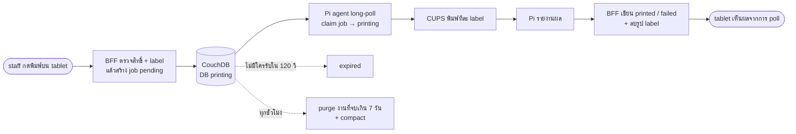
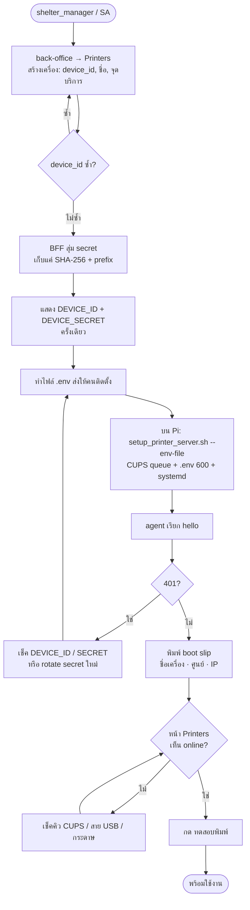
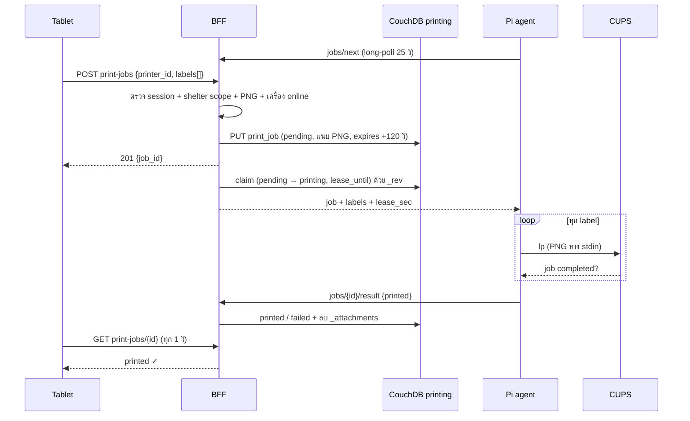
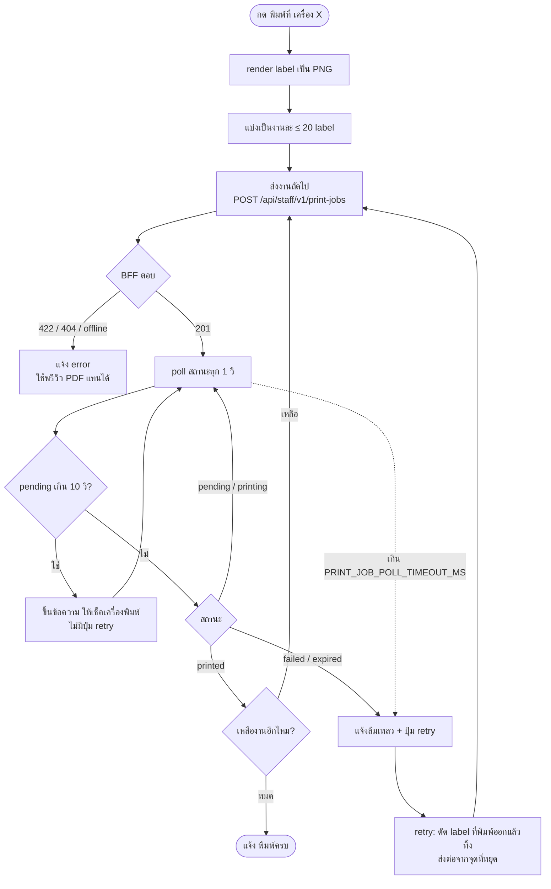
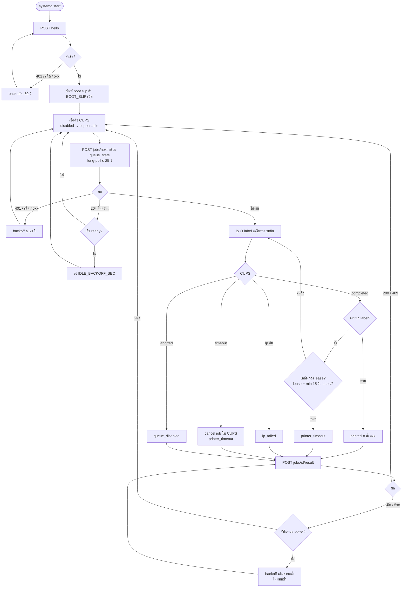
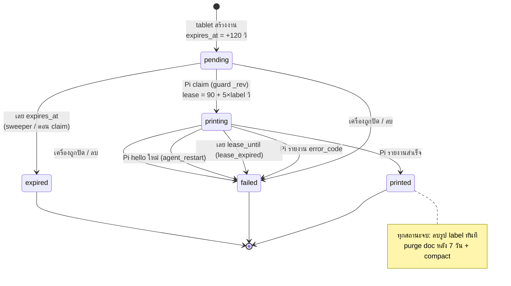
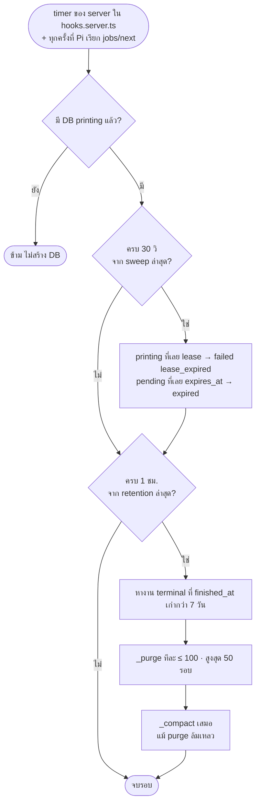

# draft-print-server — Station print server

> **สรุป (TL;DR)**
>
> - **เปลี่ยนอะไร:** staff กด "พิมพ์ทั้งครอบครัว" / "พิมพ์ที่ <เครื่อง>" แล้ว label QR 80×60 mm ออกที่เครื่องพิมพ์ของจุดนั้นทันที ไม่มี print dialog ไม่ต้องลง driver บน tablet
> - **ทำงานยังไง:** tablet ส่ง PNG ไปที่ staff BFF → BFF เก็บงานใน DB ใหม่ **`printing`** (central เท่านั้น, admin-only) → Pi agent (`printer/`) long-poll device BFF → พิมพ์ผ่าน CUPS → รายงานผล
> - **build:** DB `printing` + doc type `print_device` / `print_job` (schema_v 1) · route 3 กลุ่ม (Pi / staff / back-office) · feature `printers` · Pi agent · สิทธิ์จัดการเครื่อง = SA + `shelter_manager`
> - **ข้อจำกัด:** WAN ล่ม → พิมพ์ผ่านเครื่องพิมพ์ไม่ได้ ใช้พรีวิว PDF เดิมแทน · ทีมเสนอคำตอบครบทุกข้อแล้ว (§ข้อเสนอของทีม O-1..O-9) — เหลือ PO เคาะทั้ง CR

ที่มาและทางเลือกที่ตัดทิ้ง: §Why · สถานะ build: implement แล้วบน branch `poc-print-server` ก่อน CR ตามที่ทีมตกลงให้ทำล่วงหน้า

---

## Requirements

### Data — DB `printing` (schema.md §10)

- **FR-1** — DB `printing` อยู่ที่ central เท่านั้น: ไม่ replicate ไป edge, worker ไม่ sync เข้า MongoDB.
- **FR-2** — `_security`: `admins.roles = ["_admin"]`, `members.roles = ["_admin"]` — browser อ่าน/เขียนไม่ได้; ทุก read/write ผ่าน BFF ด้วย admin credential (`$lib/server/couch-admin.ts`).
- **FR-3** — `_revs_limit = 100`.
- **FR-4** — BFF สร้าง DB + `_security` + `_revs_limit` + Mango index (§10.3) แบบ idempotent ครั้งแรกที่ route ใด ๆ ใช้ DB (`ensurePrintingDbOnce`); housekeeping timer ไม่สร้าง DB ให้ server ที่ยังไม่มีเครื่องพิมพ์.
- **FR-5** — `print_device:{device_id}`: `device_id` ตรง `^[a-z0-9][a-z0-9-]{2,62}$`, `name` 1–80 ตัว, ผูก `shelter_code`, `station` (nullable), `host_kind` ∈ `standalone`/`kiosk`.
- **FR-6** — `print_device` เก็บ **แค่** `secret_hash` (SHA-256 hex) และ `secret_prefix` (16 ตัวแรก) — ห้ามเก็บ secret ตัวจริงในที่ใดเลย.
- **FR-7** — `print_job:{ulid}` แนบ label เป็น `_attachments` `label-NNN.png` (`image/png`) ระหว่าง `pending`/`printing` เท่านั้น.

### สถานะงานพิมพ์

- **FR-8** — สถานะ: `pending` → `printing` → `printed` | `failed`; `pending` → `expired`. `printed`/`failed`/`expired` เป็น terminal ไม่ย้อนกลับ.
- **FR-9** — ทุก write ที่ไปสถานะ terminal ตั้ง `finished_at` และ **ไม่มี `_attachments`** ใน write เดียวกัน (label ถูกลบทันทีที่งานจบ).
- **FR-10** — สร้างงาน: `expires_at = created_at + 120 วิ` (`JOB_TTL_SEC`); ไม่มีใครรับทันเวลา → `expired`.
- **FR-11** — claim: เลือกงาน `pending` ที่เก่าสุดของเครื่องนั้น, PUT เป็น `printing` พร้อม `claimed_at`, `lease_until = now + lease_sec` โดย `lease_sec = 90 + 5 × label_count`; ชน `_rev` → ข้ามไปงานถัดไป (กันพิมพ์ซ้ำเมื่อมี agent หลายตัว).
- **FR-12** — งานที่เจอว่าหมดอายุระหว่าง claim → `expired` ทันที ไม่ส่งให้ Pi.
- **FR-13** — `error_code` ฝั่ง agent: `printer_timeout` · `queue_disabled` · `lp_failed`; ฝั่ง server: `agent_restart` · `lease_expired` · `printer_inactive` · `printer_deleted`.
- **FR-14** — Pi เรียก `hello` → งาน `printing` ทั้งหมดของเครื่องนั้นเป็น `failed (agent_restart)`.
- **FR-15** — ปิดเครื่อง (`inactive`) → เขียนเครื่องเป็น inactive ก่อน แล้ว fail งาน `pending`/`printing` ของเครื่องเป็น `printer_inactive`; ลบเครื่อง → fail เป็น `printer_deleted` แล้วจึงลบ doc.
- **FR-16** — ทุกการตัดสินเรื่องเวลา (TTL, lease, online) ใช้นาฬิกา server (Pi ไม่มี RTC).

### Housekeeping / retention (PDPA)

- **FR-17** — sweeper ทุก 30 วิ (`SWEEP_INTERVAL_SEC`): `printing` ที่เลย `lease_until` → `failed (lease_expired)`; `pending` ที่เลย `expires_at` → `expired`. รันจาก timer ของ server (`hooks.server.ts` `init`) และตอน Pi poll — ไม่ขึ้นกับว่ามี Pi ทำงานอยู่.
- **FR-18** — retention ทุกชั่วโมง: `_purge` งาน terminal ที่ `finished_at` เก่ากว่า **7 วัน** (O-1) ทีละ ≤ 100 doc, สูงสุด 50 รอบต่อครั้ง.
- **FR-19** — หลัง purge ต้องสั่ง `_compact` **เสมอ** (แม้ไม่มีอะไรถูก purge หรือ purge ล้มเหลว) เพราะ revision ก่อน terminal write ยังมีรูป label.
- **FR-20** — sweep / retention ที่ล้มเหลวไม่ทำให้ request ของ Pi ล้ม; รอบถัดไปลองใหม่.

### API — Pi (`/api/v1/printer/*`, header `x-device-id` + `x-device-secret`)

- **FR-21** — `POST /hello` body `{agent_version, queue_state, local_ips[]}` → ทำ FR-14, บันทึก heartbeat (บังคับเขียน), ตอบ `{device: {device_id, name, shelter_code}, server_time, config: {wait_sec: 25, lease_sec}}` (`lease_sec` = lease ของงาน 1 label ใช้เป็นค่า fallback).
- **FR-22** — `POST /jobs/next` body `{queue_state}` → heartbeat (throttle) + sweep ถ้าถึงรอบ; `queue_state ≠ ready` → 204 ทันที; ไม่งั้น long-poll ≤ 25 วิ ผ่าน `_changes` แล้วตอบ `{job: {id, label_count, lease_sec, lease_until}, labels[]}` หรือ 204.
- **FR-23** — `POST /jobs/{id}/result` body `{printed: int≥0, error_code?}` → `printed` ถ้าไม่มี `error_code` ไม่งั้น `failed`; งานต้องเป็น `printing` ของเครื่องนี้ ไม่งั้น 409 `JOB_CONFLICT`; body ผิด → 422.
- **FR-24** — heartbeat เขียน `last_seen_at`/`queue_state`/`agent_version`/`local_ips` อย่างมากครั้งละ 20 วิ เว้นแต่ค่าเปลี่ยน; ชน `_rev` → ทิ้ง (poll ถัดไปเขียนใหม่). `local_ips` เก็บเฉพาะ IPv4/IPv6 ที่ถูกต้อง ≤ 8 ค่า.
- **FR-25** — auth ไม่ผ่าน (ไม่มีเครื่อง / secret ผิด / `inactive`) → 401 `DEVICE_AUTH_FAILED` แบบเดียวกันทุกกรณี; DB ใช้ไม่ได้ → 503 `DEPENDENCY_UNAVAILABLE`; response ไม่มีรายละเอียด upstream หรือ secret.
- **FR-26** — เทียบ secret ด้วย SHA-256 + `timingSafeEqual`.
- **FR-27** — ทุก response ของ route printer มี `cache-control: no-store`.

### API — tablet (`/api/staff/v1/*`, cookie `_session`)

- **FR-28** — `GET /printers?shelter_code=` → เครื่อง `active` ของศูนย์ เรียงตามชื่อ `{id, name, station, online, queue_state, last_seen_at}` — ไม่มี secret/hash; ต้องมี scope ศูนย์นั้นหรือเป็น SA.
- **FR-29** — `POST /print-jobs` body `{printer_id, source: walk_in|evacuee_qr, labels[]}`: labels 1–20 รูป, แต่ละรูป base64 ถูกต้อง + PNG magic bytes + ≤ 64 KB, รวม ≤ 1 MB (ผิด → 422 `INVALID_LABELS`); ผู้เรียกต้องมี scope ศูนย์**ของเครื่องพิมพ์**หรือเป็น SA; เครื่องไม่มี/inactive → 404; offline → ปฏิเสธ ไม่เข้าคิว; สำเร็จ → 201 `{job_id, expires_at}`.
- **FR-30** — "online" = `active` + `queue_state = ready` + `last_seen_at` ภายใน 90 วิ ตามนาฬิกา server.
- **FR-31** — `GET /print-jobs/{id}` → `{status, printed, label_count, error_code}` เฉพาะคนที่สร้างงาน (`created_by`) หรือ SA.

### API — back-office (`/api/back-office/printers*`)

- **FR-32** — `GET` รายการเครื่องใน scope + `online` + `local_ips` + `secret_prefix` + งานล่าสุด 1 งาน · `POST` สร้างเครื่อง คืน secret (`sk_print_` + 64 hex) **ครั้งเดียว** · `PATCH /{id}` แก้ `name`/`station`/`status` · `POST /{id}/rotate-secret` คืน secret ใหม่ครั้งเดียว · `POST /{id}/test-print` (label ทดสอบในตัว ไม่มีข้อมูลคน, `source: test`) · `DELETE /{id}`.
- **FR-33** — ทุก route ต้องเป็น SA หรือ `shelter_manager` ของศูนย์ของเครื่อง (`PRINTER_MANAGER_CAPABILITIES`, O-3); `kiosk_staff` จัดการไม่ได้.
- **FR-34** — แก้ device doc แบบ read-modify-write retry ≤ 4 ครั้งเมื่อชน `_rev` (heartbeat เขียนทับบ่อย) โดยคงค่า heartbeat ล่าสุด.

### Pi agent (`printer/`)

- **FR-35** — `printed` นับเมื่อ CUPS รายงาน job `completed` (อ่าน `job-state` ผ่าน IPP ไม่ใช่แค่ `lp` exit 0); ส่งภาพทาง stdin, job title `tent-print-job`, `-o ppi=<PRINT_PPI>`; log ไม่มี secret หรือ byte ของ label.
- **FR-36** — config จาก env: `TENT_BASE_URL` (บังคับ `https://`, ยอม `http://` เฉพาะ localhost / private / link-local IP), `DEVICE_ID`, `DEVICE_SECRET`, `PRINTER_NAME` (default `tent_xprinter`), `PRINT_PPI` (203), `PRINT_JOB_TIMEOUT_SEC` (30), `IDLE_BACKOFF_SEC` (5), `ERROR_BACKOFF_MAX_SEC` (60), `BOOT_SLIP` (true).
- **FR-37** — เริ่มทำงาน: `hello` (retry + backoff จนสำเร็จ) → พิมพ์ boot slip (ชื่อเครื่อง, ศูนย์, IP, version) ถ้า `BOOT_SLIP` เปิด.
- **FR-38** — ทุกรอบ poll เรียก `cupsenable` ถ้าคิวถูก disable แล้วรายงาน `queue_state`; log เมื่อสถานะคิวเปลี่ยน.
- **FR-39** — ใช้ `lease_sec` ของงาน (ไม่มี → ใช้ของ `hello`); หยุดส่ง label ถัดไปที่ `claimed_at + lease − min(15 วิ, lease/2)` แล้วรายงาน `printer_timeout`; label ที่ CUPS ค้างถูก cancel.
- **FR-40** — retry **เฉพาะการรายงานผล** (ไม่พิมพ์ซ้ำ) ด้วย backoff จนถึง `claimed_at + lease`; 409 → เลิก.
- **FR-41** — 401 / network / 5xx / response อ่านไม่ได้ → exponential backoff สูงสุด `ERROR_BACKOFF_MAX_SEC`.
- **FR-42** — ติดตั้งด้วย `setup_printer_server.sh --env-file`: `.env` mode 600 owner `tent-printer` group `lp`; systemd `tent-printer` รันเป็น user `tent-printer`, `NoNewPrivileges`, `ProtectSystem=strict`, `ProtectHome`, `PrivateTmp`, `Restart=always`.

### UI

- **FR-43** — `PrintLabelsButton` (feature `printers`) ใช้ใน walk-in "พิมพ์ทั้งครอบครัว" (`family-batch-print.svelte`) และหน้าโปรไฟล์ผู้อพยพ (`evacuee-qr-modal.svelte`, `source: evacuee_qr`).
- **FR-44** — label มากกว่า 20 รูปถูกแบ่งเป็นหลายงานตามลำดับ (`chunkLabels`); ส่งงานถัดไปหลังงานก่อนหน้าจบเท่านั้น.
- **FR-45** — tablet poll สถานะทุก 1 วิ จนงานจบ หรือครบ `PRINT_JOB_POLL_TIMEOUT_MS` (= TTL + lease ของงาน 20 label + sweep + 15 วิ) — ไม่ยอมให้ retry ก่อนนั้นเพราะงานอาจยังพิมพ์ออก.
- **FR-46** — งานยัง `pending` เกิน 10 วิ → แสดงข้อความให้เช็คเครื่องพิมพ์ (ไม่มีปุ่ม retry).
- **FR-47** — retry หลังล้มเหลวเริ่มต่อจากจุดที่หยุด: ไม่ส่ง label ที่พิมพ์ไปแล้วซ้ำ (ตัดตาม `printed`); งานสุดท้ายถือว่า "ส่งแล้ว" เมื่อ Pi claim (`printing`).
- **FR-48** — เครื่องที่เลือกจำไว้ต่อศูนย์ใน `localStorage` (station printer); หน้า back-office **Printers** แสดงรายการ + dialog สร้าง/แก้/แสดง secret ครั้งเดียว/rotate/ทดสอบ/ลบ.

## Flow

แผนภาพเขียนตามโค้ดบน `poc-print-server` (ชุดเดียวกับ `docs/plans/print-server-poc.md` §4). ถ้าแผนภาพกับ FR ไม่ตรงกัน ให้ถือ FR เป็นหลัก

### ภาพรวม

### ติดตั้งเครื่องใหม่ (FR-32, FR-37, FR-42)

1. `shelter_manager` เปิด back-office → Printers → สร้างเครื่อง (ชื่อ, จุดบริการ)
2. ระบบแสดง `DEVICE_ID` + `DEVICE_SECRET` **ครั้งเดียว** — ปิด dialog แล้วดูอีกไม่ได้
3. บน Pi รัน `setup_printer_server.sh --env-file <ไฟล์>` → ติดตั้ง CUPS queue, วาง `.env` (mode 600, owner `tent-printer`), เปิด systemd service
4. agent เรียก `hello` → พิมพ์ boot slip (ชื่อเครื่อง, ศูนย์, IP) ให้รู้ว่าต่อถูกเครื่อง
5. หน้า Printers เห็นเครื่องเป็น online → กด "ทดสอบพิมพ์"

### สั่งพิมพ์ (FR-11, FR-22, FR-29, FR-43..47)

**ฝั่ง tablet (`PrintLabelsButton`)**

### Pi agent loop (FR-35..41)

### สถานะงานพิมพ์ (FR-8..20)

**Housekeeping บน server**

## Acceptance

- [ ] DB `printing` ถูกสร้างพร้อม `_security` admin-only, `_revs_limit 100` และ index ครบ §10.3; browser ด้วย cookie staff อ่าน DB ไม่ได้
- [ ] สร้างเครื่องแล้วเห็น secret ครั้งเดียว; doc มีแค่ `secret_hash` + `secret_prefix`
- [ ] secret ผิด / เครื่องไม่มี / inactive → 401 body เดียวกัน
- [ ] staff ศูนย์ B สั่งพิมพ์ไปเครื่องของศูนย์ A ไม่ได้; staff ดูสถานะงานของคนอื่นไม่ได้
- [ ] งานที่จบแล้วไม่มี `_attachments`; งานที่จบเกิน 7 วันถูก purge และ DB ถูก compact
- [ ] สั่งพิมพ์ไปเครื่อง offline → ปฏิเสธทันที ไม่เกิดงาน
- [ ] ทดสอบบนเครื่องจริง (Pi + XP-365B): ปิด Pi เกิน 120 วิ แล้วเปิด → งานเก่าเป็น `expired` ไม่พิมพ์ออกมา · ถอดกระดาษระหว่างพิมพ์ → งาน `failed` ไม่หลุดออกมาทีหลัง และงานถัดไปพิมพ์ได้โดยไม่ต้อง SSH · รัน agent 2 ตัวด้วย device เดียวกัน → แต่ละงานพิมพ์ครั้งเดียว · secret ผิด → 401 และ agent backoff · rotate secret ขณะ agent ทำงาน → 401 ทันที
- [ ] ครอบครัว > 20 คน → แบ่งงาน พิมพ์ครบตามลำดับ; ล้มกลางทาง → retry ไม่พิมพ์คนที่ออกแล้วซ้ำ

## Change

| ส่วน           | ก่อน                                            | หลัง                                                                                                        |
| -------------- | ----------------------------------------------- | ----------------------------------------------------------------------------------------------------------- |
| พิมพ์ label QR | พรีวิว PDF → print dialog ของ browser บน tablet | ปุ่ม "พิมพ์ที่ <เครื่อง>" ส่งเข้าคิว → Pi พิมพ์ (พรีวิว PDF ยังอยู่เป็นทางสำรอง)                            |
| DB             | —                                               | `printing` (central only, admin-only)                                                                       |
| doc type       | —                                               | `print_device` v1, `print_job` v1                                                                           |
| API            | —                                               | `/api/v1/printer/*` · `/api/staff/v1/printers` · `/api/staff/v1/print-jobs*` · `/api/back-office/printers*` |
| สิทธิ์         | —                                               | `PRINTER_MANAGER_CAPABILITIES = [shelter_manager]` (+ SA)                                                   |
| อุปกรณ์        | —                                               | Raspberry Pi + CUPS + XP-365B + agent `tent-printer`                                                        |

## Impact

- **ข้อมูลส่วนบุคคล:** label มีชื่อ-นามสกุล, โซน, checklist การรับเข้า และ QR (`evacuee._id`) — อยู่ใน DB `printing` เฉพาะระหว่างงานยังไม่จบ (≤ 120 วิ + lease); doc ที่ไม่มีรูปเก็บ 7 วัน.
- **ไม่กระทบ** DB อื่น, worker, MongoDB, public plane, kiosk scanner flow.
- **Ops:** ต้องติดตั้ง Pi ต่อจุดบริการ + ส่ง `.env` ให้เครื่อง; server ที่ไม่มีเครื่องพิมพ์ไม่ถูกสร้าง DB.
- **WAN ล่ม:** พิมพ์ผ่านเครื่องพิมพ์ไม่ได้ (BFF อยู่ central) — ใช้พรีวิว PDF.

## Migration

- doc type ใหม่ทั้งคู่ (schema_v 1) — ไม่มี backfill, ไม่มี bump ของ type อื่น.
- DB สร้างเองตอนใช้งานครั้งแรก (FR-4) — ไม่ต้องรัน provisioning script.

## ข้อเสนอของทีม (O-1..O-9)

คำตอบทั้งหมดเป็น **ข้อเสนอของทีม = as-built** รอ PO เคาะ

| #   | คำถาม                         | ข้อเสนอของทีม                                                                    |
| --- | ----------------------------- | -------------------------------------------------------------------------------- |
| O-1 | เก็บประวัติงานพิมพ์นานเท่าไร  | 7 วัน แล้ว purge + compact · รูป label ลบทันทีที่งานจบ                           |
| O-2 | ใครสั่งพิมพ์ได้               | staff ทุกคนที่มี scope ศูนย์ของเครื่อง + SA                                      |
| O-3 | ใครจัดการเครื่อง              | SA + `shelter_manager` (ไม่รวม `kiosk_staff` ต่างจาก scanner)                    |
| O-4 | WAN ล่ม                       | ไม่รองรับ — ใช้พรีวิว PDF เดิม                                                   |
| O-5 | สิทธิ์ `cupsenable` ของ agent | user `tent-printer` อยู่ group `lp` ให้ enable คิวเองได้ ไม่ต้อง SSH             |
| O-6 | TTL / lease                   | TTL 120 วิ · lease 90 + 5×label · online ภายใน 90 วิ                             |
| O-7 | ขนาดงาน                       | ≤ 20 label/งาน, ≤ 64 KB/รูป, ≤ 1 MB/งาน — มากกว่านั้นแบ่งงานที่ tablet           |
| O-8 | ข้อมูลบน label                | ชื่อ-นามสกุล, โซน, checklist, QR (`_id`) — เหมือน label kiosk                    |
| O-9 | ส่ง secret ไปที่ Pi           | admin copy ใส่ `.env` เอง (ยังไม่มี pairing code) · ยอม `http://` บน private LAN |

ข้อที่ทีมเสนอให้ทำเพิ่มก่อน production (ไม่อยู่ใน CR นี้): เตือนในหน้า admin เมื่อ secret ถูกใช้ซ้อน (IP สลับไปมา) และจำกัดความถี่ `hello` — ดู `docs/plans/print-server-poc.md` §5.4, §7

## Why

- **ปัญหา:** print dialog บน tablet ช้า ต้องลง driver/ตั้งค่าขนาดกระดาษทุกเครื่อง และพิมพ์ทั้งครอบครัวต้องกดหลายรอบ.
- **device + BFF (ไม่ใช่ Couch user ต่อ Pi):** CouchDB ไม่มีการจำกัดสิทธิ์อ่านระดับ doc — Couch user ของ Pi จะอ่านงานของทุกศูนย์ใน DB `printing` ได้ · secret ต่อเครื่อง rotate/ปิดได้จาก back-office · BFF ใช้นาฬิกา server ตัดสิน TTL/lease · ตรรกะคิวอยู่ที่เดียว (TS) ไม่ซ้ำใน Python.
- **Pi pull (ไม่ใช่ tablet push ไปที่ Pi):** Pi ไม่ต้องเปิด port / ทำ cert บน LAN · ไม่ติด mixed content (แอป HTTPS เรียก `http://<IP>` ไม่ได้) · cookie `_session` เป็น HttpOnly ผูก origin central จึงส่งให้ Pi ตรวจเองไม่ได้ · ได้คิวกลาง retry และ audit.
- **ไม่ใช้ FastAPI:** FastAPI เป็น public plane อ่าน MongoDB; printing เป็นงาน staff บน CouchDB ที่ BFF มี session/RBAC อยู่แล้ว.
- **ไม่ใช้ PDF + print dialog ต่อ:** ข้อจำกัดเดิมข้างบน; ยังเก็บไว้เป็นทางสำรองตอน WAN ล่มหรือเครื่องพิมพ์เสีย.

## Decision log

| วันที่     | เรื่อง                                                                                                                 |
| ---------- | ---------------------------------------------------------------------------------------------------------------------- |
| 2026-10-22 | ทีมตกลง build ทุก phase ก่อน CR บน `poc-print-server`                                                                  |
| 2026-10-23 | ทีมเสนอคำตอบ O-1..O-9 (= as-built) · ไม่มีข้อเปิดค้าง                                                                  |
| 2026-10-27 | เขียน draft CR ใหม่จากโค้ด (ฉบับเดิมหายจาก working tree หลัง merge `develop`) · เพิ่ม `docs/plans/print-server-poc.md` · เพิ่ม §Flow (flowchart / state diagram) |
