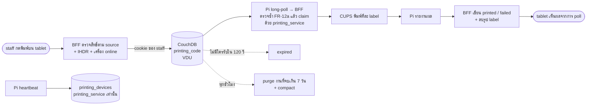
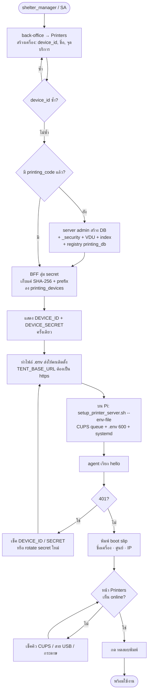
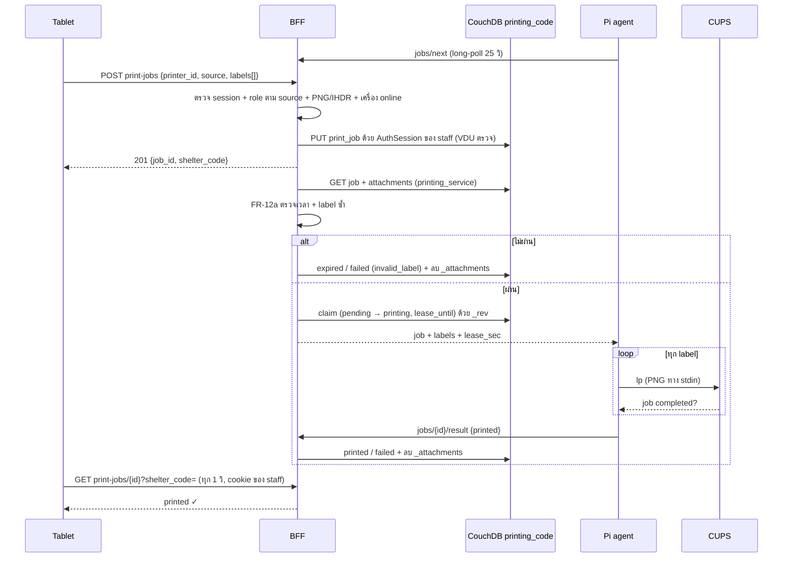
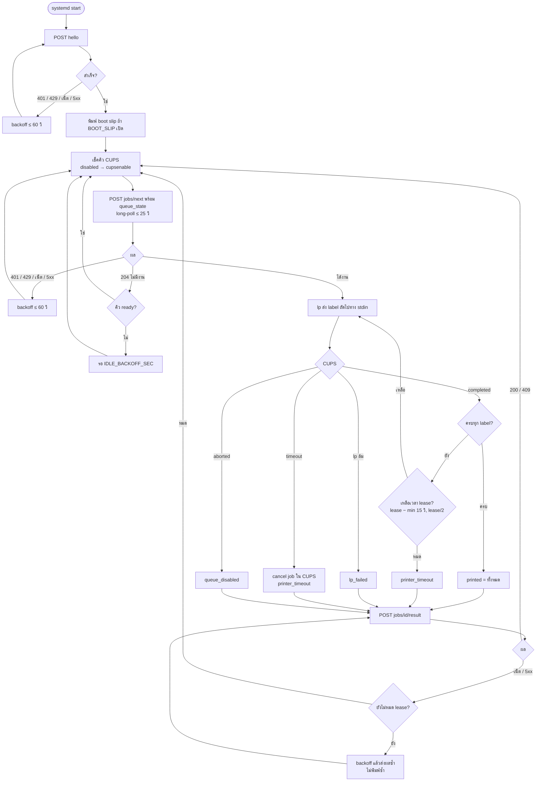
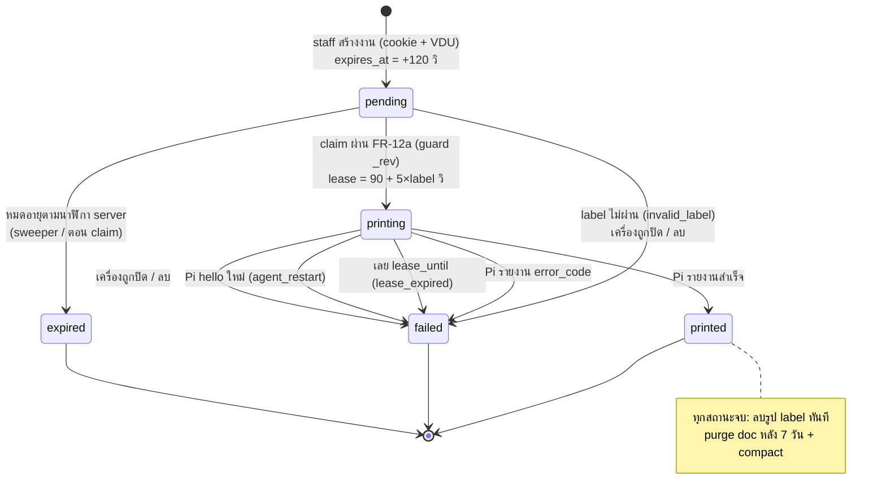
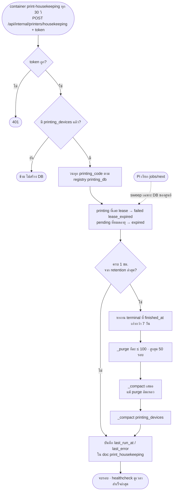

# draft-print-server — Station print server

> **สรุป (TL;DR)**
>
> - **เปลี่ยนอะไร:** staff กด "พิมพ์ทั้งครอบครัว" / "พิมพ์ที่ <เครื่อง>" แล้ว label QR 80×60 mm ออกที่เครื่องพิมพ์ของจุดนั้นทันที ไม่มี print dialog ไม่ต้องลง driver บน tablet
> - **ทำงานยังไง:** tablet ส่ง PNG ไปที่ staff BFF → BFF ตรวจแล้ว **เขียนงานด้วย cookie ของ staff** ลง DB ของศูนย์ **`printing_{shelter_code}`** (VDU บังคับ) → Pi agent (`printer/`) long-poll device BFF → BFF claim งานด้วย service user **`printing_service`** และตรวจ label ซ้ำก่อนส่ง → พิมพ์ผ่าน CUPS → รายงานผล
> - **build:** DB `printing_devices` (เครื่อง, service user เท่านั้น) + `printing_{shelter_code}` (งาน, staff ของศูนย์ + VDU) · route 4 กลุ่ม (Pi / staff / back-office / internal) · container `print-housekeeping` · feature `printers` · Pi agent · สิทธิ์จัดการเครื่อง = SA + `shelter_manager`
> - **ข้อจำกัด:** WAN ล่ม → พิมพ์ผ่านเครื่องพิมพ์ไม่ได้ ใช้พรีวิว PDF เดิมแทน · staff ในศูนย์เดียวกันอ่านงานพิมพ์ของกันได้ผ่าน `/couch` (FR-31) · ยังมีข้อเปิด O-10..O-12 ให้ PO เคาะ

ที่มาและทางเลือกที่ตัดทิ้ง: §Why · สถานะ build: POC บน branch `poc-print-server` ตรงกับฉบับ 2026-10-27 — ส่วนที่ปรับ 2026-10-29 ข้างล่าง **ยังไม่ได้ implement**

> **ส่วนที่ปรับ 2026-10-29 — เสนอโดยทีม kiosk ตาม review PR #932 (proposed)**
>
> - **แยก DB (review รอบ 1 ข้อ 6 + รอบ 2):** `print_device` ย้ายไป `printing_devices` · คิวงานแยกเป็น `printing_{shelter_code}` ต่อศูนย์ — heartbeat ไม่ปลุก `_changes` ของงาน และ feed ของ Pi ถูกปลุกเฉพาะงานของศูนย์ตัวเอง (FR-1..4, FR-50)
> - **credential (รอบ 2):** งานที่ staff สั่ง (สร้างงาน, ดูสถานะ, test-print) เขียน/อ่านด้วย cookie ของ staff · งานของ Pi, housekeeping, จัดการเครื่อง ใช้ service user `printing_service` (admin เฉพาะ DB printing) · server admin ใช้เฉพาะตอน provision DB (FR-2, FR-2a)
> - **จำกัดสองชั้น:** VDU กันตอนเขียน (FR-51) + BFF ตรวจ label/เวลาซ้ำตอน claim ด้วยนาฬิกา server (FR-12a) — เพราะ staff เขียน DB ตรงผ่าน `/couch` ได้โดยไม่ผ่าน BFF และ VDU อ่าน byte ของ PNG ไม่ได้
> - **PNG (รอบ 1 ข้อ 1):** ตรวจ IHDR ให้ตรงขนาด label เป๊ะ ทั้งที่ BFF ตอนสร้างและตอน claim (FR-29, FR-12a)
> - **สิทธิ์สั่งพิมพ์ตาม `source` (รอบ 1 ข้อ 8, O-2):** FR-29a
> - **housekeeping (รอบ 1 ข้อ 4):** ย้ายจาก timer ใน `hooks.server.ts` ไป container `print-housekeeping` + `last_run_at` + healthcheck (FR-17, FR-17a)
> - **Pi:** `TENT_BASE_URL` ต้องเป็น `https://` ยกเว้น loopback (รอบ 1 ข้อ 2, O-9) · nginx `limit_conn` ≤ 2 ต่อ `x-device-id` (ข้อ 7) · สิทธิ์ `cupsenable` ต้องทดสอบบน Pi (ข้อ 12, O-5) · `host_kind: kiosk` มี 2 credential แยก (ข้อ 14)
> - **เอกสาร:** §Impact รูป label ค้างได้ ~1 ชม. หลังงานจบ (ข้อ 9) · FR-31 อ่อนลง · เพิ่ม FR-49 (`_changes` เส้นเดียวต่อ process) · Acceptance load test · §Compromise

---

## Requirements

### Data — DB `printing_devices` + `printing_{shelter_code}` (schema.md §10)

- **FR-1** — DB `printing_devices` (เครื่องทั้งระบบ) และ `printing_{shelter_code}` (คิวงานต่อศูนย์, ชื่อ DB ใช้ `shelter_code` ตัวเล็กแบบเดียวกับ `shelter_{shelter_code}`) อยู่ที่ central เท่านั้น: ไม่ replicate ไป edge, worker ไม่ sync เข้า MongoDB. _(ปรับ 2026-10-29: เดิม DB `printing` เดียว)_
- **FR-2** — `_security`: _(ปรับ 2026-10-29)_
  - `printing_devices`: `admins.names = ["printing_service"]`, `members.names = ["printing_service"]` — browser และ staff อ่าน/เขียนไม่ได้
  - `printing_{code}`: `admins.names = ["printing_service"]`, `members.roles = ["shelter:{CODE}", "system_admin"]`, `members.names = ["printing_service"]` + VDU (FR-51)
- **FR-2a** — credential ที่ BFF ใช้กับ CouchDB: _(ใหม่ 2026-10-29)_

  | งาน                                                                                                           | credential                                                                  |
  | ------------------------------------------------------------------------------------------------------------- | --------------------------------------------------------------------------- |
  | staff สร้างงาน (`POST /api/staff/v1/print-jobs`) · ดูสถานะ (`GET /api/staff/v1/print-jobs/{id}`) · test-print | `AuthSession` ของผู้เรียก (helper เขียนในนามของ user ใหม่ใน `$lib/server/`) |
  | tablet ดูรายการเครื่อง (`GET /api/staff/v1/printers`)                                                         | `printing_service` (เครื่องอยู่ `printing_devices` ที่ staff อ่านไม่ได้)    |
  | Pi: `hello` / `jobs/next` / `result` / heartbeat · claim                                                      | `printing_service`                                                          |
  | housekeeping: sweep / `_purge` / `_compact`                                                                   | `printing_service`                                                          |
  | สร้าง / แก้ / rotate secret / ลบเครื่อง                                                                       | `printing_service`                                                          |
  | สร้าง DB + `_security` + VDU + index                                                                          | server admin (`$lib/server/couch-admin.ts`) เฉพาะตอน provision (FR-4)       |

  `printing_service` เป็น CouchDB user ไม่มี role, เป็น admin เฉพาะ DB ใน FR-2 — ถ้าโค้ด printer ถูกเจาะก็แตะ DB อื่นไม่ได้; credential อยู่ใน env ฝั่ง server เท่านั้น

- **FR-3** — `_revs_limit`: `printing_devices` = 10 (heartbeat สร้าง ~4,320 revision ต่อเครื่องต่อวัน) · `printing_{code}` = 100. _(ปรับ 2026-10-29)_
- **FR-4** — provision แบบ idempotent ด้วย server admin: _(ปรับ 2026-10-29)_
  - `printing_devices` + `_security` + index — ครั้งแรกที่ route ใด ๆ ใช้
  - `printing_{code}` + `_security` + design doc VDU + index — ตอนสร้างเครื่องแรกของศูนย์ (lazy) แล้วเขียน `printing_db:{code}` ลง `printing_devices` เป็น registry ให้ housekeeping วนครบทุก DB แม้เครื่องถูกลบหมดแล้ว
  - ลบ `printing_{code}` ตอนปิดศูนย์ (O-11)
  - housekeeping ไม่สร้าง DB ให้ server ที่ยังไม่มีเครื่องพิมพ์
- **FR-5** — `print_device:{device_id}` (ใน `printing_devices`): `device_id` ตรง `^[a-z0-9][a-z0-9-]{2,62}$`, `name` 1–80 ตัว, ผูก `shelter_code`, `station` (nullable), `host_kind` ∈ `standalone`/`kiosk`.
- **FR-5a** — `host_kind: kiosk` → ตู้นั้นมี **2 credential แยกกัน** (scanner device + print device) สิทธิ์ต่างกันและ revoke แยกได้ · `print_device` มี `kiosk_device_id` (nullable, เฉพาะ `kiosk`) ชี้ scanner device ของตู้เดียวกัน · หน้า back-office แสดงว่าเครื่องไหนอยู่ตู้เดียวกัน. _(ใหม่ 2026-10-29)_
- **FR-6** — `print_device` เก็บ **แค่** `secret_hash` (SHA-256 hex) และ `secret_prefix` (16 ตัวแรก) — ห้ามเก็บ secret ตัวจริงในที่ใดเลย.
- **FR-7** — `print_job:{ulid}` (ใน `printing_{code}`) แนบ label เป็น `_attachments` `label-NNN.png` (`image/png`) ระหว่าง `pending`/`printing` เท่านั้น; มี `shelter_code`, `printer_id`, `source`, `label_count`, `created_by`, `created_at`, `expires_at`.

### สถานะงานพิมพ์

- **FR-8** — สถานะ: `pending` → `printing` → `printed` | `failed`; `pending` → `expired` | `failed`. `printed`/`failed`/`expired` เป็น terminal ไม่ย้อนกลับ.
- **FR-9** — ทุก write ที่ไปสถานะ terminal ตั้ง `finished_at` และ **ไม่มี `_attachments`** ใน write เดียวกัน (label ถูกลบทันทีที่งานจบ).
- **FR-10** — สร้างงานผ่าน BFF: `created_at` = นาฬิกา server, `expires_at = created_at + 120 วิ` (`JOB_TTL_SEC`); ไม่มีใครรับทันเวลา → `expired`.
- **FR-11** — claim: เลือกงาน `pending` ที่เก่าสุดของเครื่องนั้น ผ่าน FR-12a แล้ว PUT เป็น `printing` พร้อม `claimed_at`, `lease_until = now + lease_sec` โดย `lease_sec = 90 + 5 × label_count`; ชน `_rev` → ข้ามไปงานถัดไป (กันพิมพ์ซ้ำเมื่อมี agent หลายตัว).
- **FR-12** — งานที่หมดอายุตาม FR-12a ระหว่าง claim → `expired` ทันที ไม่ส่งให้ Pi.
- **FR-12a** — ตรวจซ้ำตอน claim (ด้วย `printing_service` + นาฬิกา server) เพราะงานอาจถูกเขียนตรงเข้า DB โดยไม่ผ่าน BFF: _(ใหม่ 2026-10-29)_
  - **เวลา:** ไม่เชื่อ `created_at`/`expires_at` ที่มากับ doc — `created_at` อยู่ในอนาคตเกิน 5 วิ หรืออายุจริง `min(expires_at, created_at + 120 วิ)` เลยแล้ว → `expired`
  - **label:** จำนวน attachment = `label_count` (1–20) · ทุกรูปมี PNG magic bytes, ≤ 64 KB, IHDR width/height = `kioskLabelDots()` และ bit depth / color type ตรงกับที่ renderer ใช้ — ไม่ผ่าน → `failed (invalid_label)` ไม่ส่งรูปให้ Pi
  - `printer_id` ต้องเป็นเครื่องที่ poll อยู่ และ `shelter_code` ของเครื่องต้องตรงกับ DB
- **FR-13** — `error_code` ฝั่ง agent: `printer_timeout` · `queue_disabled` · `lp_failed`; ฝั่ง server: `agent_restart` · `lease_expired` · `printer_inactive` · `printer_deleted` · `invalid_label` _(เพิ่ม 2026-10-29)_.
- **FR-14** — Pi เรียก `hello` → งาน `printing` ทั้งหมดของเครื่องนั้นเป็น `failed (agent_restart)` (ความเสี่ยง DoS ยอมรับใน §Compromise ข้อ 3).
- **FR-15** — ปิดเครื่อง (`inactive`) → เขียนเครื่องเป็น inactive ก่อน แล้ว fail งาน `pending`/`printing` ของเครื่องเป็น `printer_inactive`; ลบเครื่อง → fail เป็น `printer_deleted` แล้วจึงลบ doc.
- **FR-16** — ทุกการตัดสินเรื่องเวลา (TTL, lease, online) ใช้นาฬิกา server (Pi ไม่มี RTC, tablet / doc ที่เขียนตรงเชื่อไม่ได้).

### Housekeeping / retention (PDPA)

- **FR-17** — container `print-housekeeping` (image เดียวกับ frontend แบบ `import-worker`) เรียก `POST /api/internal/printers/housekeeping` ทุก 30 วิ (`SWEEP_INTERVAL_SEC`) ด้วย `Authorization: Bearer <PRINT_HOUSEKEEPING_TOKEN>` (env ฝั่ง server เท่านั้น) · BFF **ไม่ตั้ง timer เอง** (`hooks.server.ts` ไม่มี `init` ของ printer) เพื่อไม่ให้รันซ้ำทุก process / replica · route วนทุก `printing_{code}` ตาม registry `printing_db:*` (FR-4): `printing` ที่เลย `lease_until` → `failed (lease_expired)`; `pending` ที่หมดอายุตาม FR-12a → `expired`. sweep เฉพาะ DB ของเครื่องตอน Pi poll ยังคงไว้. _(ปรับ 2026-10-29)_
- **FR-17a** — บันทึก `last_run_at` / `last_retention_at` / `last_error` ลง doc `print_housekeeping` ใน `printing_devices` · container healthcheck = unhealthy เมื่อเรียกสำเร็จครั้งล่าสุดเกิน 2 นาที (กัน purge หยุดเงียบ). _(ใหม่ 2026-10-29)_
- **FR-18** — retention ทุกชั่วโมง ต่อ `printing_{code}`: `_purge` งาน terminal ที่ `finished_at` เก่ากว่า **7 วัน** (O-1) ทีละ ≤ 100 doc, สูงสุด 50 รอบต่อครั้ง.
- **FR-19** — หลัง purge ต้องสั่ง `_compact` **เสมอ** (แม้ไม่มีอะไรถูก purge หรือ purge ล้มเหลว) เพราะ revision ก่อน terminal write ยังมีรูป label · compact `printing_devices` ทุกชั่วโมงด้วย (revision ของ heartbeat). _(ปรับ 2026-10-29)_
- **FR-20** — sweep / retention ที่ล้มเหลวไม่ทำให้ request ของ Pi ล้ม; รอบถัดไปลองใหม่; DB หนึ่งล้มไม่หยุด DB อื่น.

### API — Pi (`/api/v1/printer/*`, header `x-device-id` + `x-device-secret`)

- **FR-21** — `POST /hello` body `{agent_version, queue_state, local_ips[]}` → ทำ FR-14, บันทึก heartbeat (บังคับเขียน), ตอบ `{device: {device_id, name, shelter_code}, server_time, config: {wait_sec: 25, lease_sec}}` (`lease_sec` = lease ของงาน 1 label ใช้เป็นค่า fallback).
- **FR-22** — `POST /jobs/next` body `{queue_state}` → heartbeat (throttle) + sweep DB ของศูนย์ถ้าถึงรอบ; `queue_state ≠ ready` → 204 ทันที; ไม่งั้น long-poll ≤ 25 วิ ผ่าน `_changes` ของ `printing_{code}` แล้วตอบ `{job: {id, label_count, lease_sec, lease_until}, labels[]}` หรือ 204.
- **FR-23** — `POST /jobs/{id}/result` body `{printed: int≥0, error_code?}` → `printed` ถ้าไม่มี `error_code` ไม่งั้น `failed`; งานต้องเป็น `printing` ของเครื่องนี้ ไม่งั้น 409 `JOB_CONFLICT`; body ผิด → 422.
- **FR-24** — heartbeat เขียน `last_seen_at`/`queue_state`/`agent_version`/`local_ips` ลง `printing_devices` อย่างมากครั้งละ 20 วิ เว้นแต่ค่าเปลี่ยน; ชน `_rev` → ทิ้ง (poll ถัดไปเขียนใหม่). `local_ips` เก็บเฉพาะ IPv4/IPv6 ที่ถูกต้อง ≤ 8 ค่า. heartbeat **ไม่แตะ** `printing_{code}`.
- **FR-25** — auth ไม่ผ่าน (ไม่มีเครื่อง / secret ผิด / `inactive`) → 401 `DEVICE_AUTH_FAILED` แบบเดียวกันทุกกรณี; DB ใช้ไม่ได้ → 503 `DEPENDENCY_UNAVAILABLE`; response ไม่มีรายละเอียด upstream หรือ secret.
- **FR-26** — เทียบ secret ด้วย SHA-256 + `timingSafeEqual` ผ่าน helper กลาง `$lib/server/device-auth/` ที่ใช้ร่วมกับ scanner (ไม่เปลี่ยนพฤติกรรม). _(ปรับ 2026-10-29)_
- **FR-27** — ทุก response ของ route printer มี `cache-control: no-store`.
- **FR-27a** — nginx จำกัด connection พร้อมกัน ≤ 2 ต่อ `x-device-id` ที่ `/api/v1/printer/` (`limit_conn`, ตามแนว CR-188) เกิน → 429 · agent ถือ 429 เป็น error แล้ว backoff (FR-41). _(ใหม่ 2026-10-29)_

### API — tablet (`/api/staff/v1/*`, cookie `_session`)

- **FR-28** — `GET /printers?shelter_code=` → เครื่อง `active` ของศูนย์ เรียงตามชื่อ `{id, name, station, online, queue_state, last_seen_at}` — ไม่มี secret/hash/`local_ips`; ต้องมี scope ศูนย์นั้นหรือเป็น SA.
- **FR-29** — `POST /print-jobs` body `{printer_id, source: walk_in|evacuee_qr, labels[]}`: labels 1–20 รูป, แต่ละรูป base64 ถูกต้อง + PNG magic bytes + ≤ 64 KB + **IHDR width/height = `kioskLabelDots()` และ bit depth / color type ตรงกับ renderer**, รวม ≤ 1 MB (ผิด → 422 `INVALID_LABELS`); ผู้เรียกต้องผ่าน FR-29a สำหรับศูนย์**ของเครื่องพิมพ์**; เครื่องไม่มี/inactive → 404; offline → ปฏิเสธ ไม่เข้าคิว; ผ่านแล้ว PUT ลง `printing_{code}` ด้วย cookie ของผู้เรียก (FR-2a); สำเร็จ → 201 `{job_id, shelter_code, expires_at}`. _(ปรับ 2026-10-29)_
- **FR-29a** — สิทธิ์สั่งพิมพ์ตาม `source` (บังคับทั้งที่ BFF และ VDU): _(ใหม่ 2026-10-29, แทน O-2 เดิม)_

  | `source`     | ใครสั่งได้                                                                    |
  | ------------ | ----------------------------------------------------------------------------- |
  | `walk_in`    | `registration_staff` หรือ `shelter_manager` ของศูนย์เครื่อง · SA              |
  | `evacuee_qr` | `registration_staff` หรือ `shelter_manager` ของศูนย์เครื่อง · SA              |
  | `test`       | `shelter_manager` ของศูนย์เครื่อง · SA (ผ่าน back-office test-print เท่านั้น) |

  `walk_in` / `evacuee_qr` ใช้ role ชุดเดียวกับ guard `requireEvacueeRegistration` ของหน้าที่ปุ่มพิมพ์อยู่ (walk-in, โปรไฟล์ผู้อพยพ) · role คือของ staff ที่สั่งพิมพ์ (`userCtx.roles`) ไม่ใช่ของเครื่อง

- **FR-30** — "online" = `active` + `queue_state = ready` + `last_seen_at` ภายใน 90 วิ ตามนาฬิกา server.
- **FR-31** — `GET /print-jobs/{id}?shelter_code=` → `{status, printed, label_count, error_code}` อ่านจาก `printing_{code}` ด้วย cookie ของผู้เรียก; BFF ตอบเฉพาะคนที่สร้างงาน (`created_by`) หรือ SA. **ข้อจำกัด:** CouchDB กันการอ่านระดับ doc ไม่ได้ — staff ที่มี role `shelter:{CODE}` อ่านงานทุกงานของศูนย์ (รวมรูป label ระหว่าง `pending`/`printing`) ได้ตรงผ่าน `/couch` ระดับเปิดเผยเท่ากับ `shelter_{code}` ที่อ่านได้อยู่แล้ว. _(ปรับ 2026-10-29)_

### API — back-office (`/api/back-office/printers*`)

- **FR-32** — `GET` รายการเครื่องใน scope + `online` + `local_ips` + `secret_prefix` + `kiosk_device_id` + งานล่าสุด 1 งาน · `POST` สร้างเครื่อง (provision `printing_{code}` ถ้ายังไม่มี) คืน secret (`sk_print_` + 64 hex) **ครั้งเดียว** · `PATCH /{id}` แก้ `name`/`station`/`status` · `POST /{id}/rotate-secret` คืน secret ใหม่ครั้งเดียว · `POST /{id}/test-print` (label ทดสอบในตัว ไม่มีข้อมูลคน, `source: test`, เขียนด้วย cookie ของผู้เรียก) · `DELETE /{id}`.
- **FR-33** — ทุก route ต้องเป็น SA หรือ `shelter_manager` ของศูนย์ของเครื่อง (`PRINTER_MANAGER_CAPABILITIES`, O-3); `kiosk_staff` จัดการไม่ได้.
- **FR-34** — แก้ device doc แบบ read-modify-write retry ≤ 4 ครั้งเมื่อชน `_rev` (heartbeat เขียนทับบ่อย) โดยคงค่า heartbeat ล่าสุด.

### API — internal

- **FR-34a** — `POST /api/internal/printers/housekeeping` รับเฉพาะ `Authorization: Bearer <PRINT_HOUSEKEEPING_TOKEN>` (เทียบแบบ constant-time) ไม่มี/ผิด → 401 · ไม่เปิดผ่าน nginx ไปข้างนอก (เรียกใน network ของ compose) · ตอบ `{swept, purged, compacted, errors}`. _(ใหม่ 2026-10-29)_

### Pi agent (`printer/`)

- **FR-35** — `printed` นับเมื่อ CUPS รายงาน job `completed` (อ่าน `job-state` ผ่าน IPP ไม่ใช่แค่ `lp` exit 0); ส่งภาพทาง stdin, job title `tent-print-job`, `-o ppi=<PRINT_PPI>`; log ไม่มี secret หรือ byte ของ label.
- **FR-36** — config จาก env: `TENT_BASE_URL` (บังคับ `https://`, ยอม `http://` **เฉพาะ loopback** สำหรับ dev — ไม่ยอม private / link-local แล้ว), `DEVICE_ID`, `DEVICE_SECRET`, `PRINTER_NAME` (default `tent_xprinter`), `PRINT_PPI` (203), `PRINT_JOB_TIMEOUT_SEC` (30), `IDLE_BACKOFF_SEC` (5), `ERROR_BACKOFF_MAX_SEC` (60), `BOOT_SLIP` (true). _(ปรับ 2026-10-29)_
- **FR-37** — เริ่มทำงาน: `hello` (retry + backoff จนสำเร็จ) → พิมพ์ boot slip (ชื่อเครื่อง, ศูนย์, IP, version) ถ้า `BOOT_SLIP` เปิด.
- **FR-38** — ทุกรอบ poll เรียก `cupsenable` ถ้าคิวถูก disable แล้วรายงาน `queue_state`; log เมื่อสถานะคิวเปลี่ยน.
- **FR-39** — ใช้ `lease_sec` ของงาน (ไม่มี → ใช้ของ `hello`); หยุดส่ง label ถัดไปที่ `claimed_at + lease − min(15 วิ, lease/2)` แล้วรายงาน `printer_timeout`; label ที่ CUPS ค้างถูก cancel.
- **FR-40** — retry **เฉพาะการรายงานผล** (ไม่พิมพ์ซ้ำ) ด้วย backoff จนถึง `claimed_at + lease`; 409 → เลิก.
- **FR-41** — 401 / 429 / network / 5xx / response อ่านไม่ได้ → exponential backoff สูงสุด `ERROR_BACKOFF_MAX_SEC`.
- **FR-42** — ติดตั้งด้วย `setup_printer_server.sh --env-file`: `.env` mode 600 owner `tent-printer`; systemd `tent-printer` รันเป็น user `tent-printer`, `NoNewPrivileges`, `ProtectSystem=strict`, `ProtectHome`, `PrivateTmp`, `Restart=always` · สิทธิ์ `cupsenable` ให้แคบที่สุดที่ทดสอบผ่าน: group `lp` ถ้าพอ ไม่งั้น polkit / sudoers ที่อนุญาตเฉพาะ `cupsenable <queue นี้>` — **ไม่ใส่ `tent-printer` ใน group `lpadmin`** (O-5). _(ปรับ 2026-10-29)_

### UI

- **FR-43** — `PrintLabelsButton` (feature `printers`) ใช้ใน walk-in "พิมพ์ทั้งครอบครัว" (`family-batch-print.svelte`, `source: walk_in`) และหน้าโปรไฟล์ผู้อพยพ (`evacuee-qr-modal.svelte`, `source: evacuee_qr`); ซ่อนปุ่มเมื่อผู้ใช้ไม่ผ่าน FR-29a.
- **FR-44** — label มากกว่า 20 รูปถูกแบ่งเป็นหลายงานตามลำดับ (`chunkLabels`); ส่งงานถัดไปหลังงานก่อนหน้าจบเท่านั้น.
- **FR-45** — tablet poll สถานะทุก 1 วิ จนงานจบ หรือครบ `PRINT_JOB_POLL_TIMEOUT_MS` (= TTL + lease ของงาน 20 label + sweep + 15 วิ) — ไม่ยอมให้ retry ก่อนนั้นเพราะงานอาจยังพิมพ์ออก.
- **FR-46** — งานยัง `pending` เกิน 10 วิ → แสดงข้อความให้เช็คเครื่องพิมพ์ (ไม่มีปุ่ม retry).
- **FR-47** — retry หลังล้มเหลวเริ่มต่อจากจุดที่หยุด: ไม่ส่ง label ที่พิมพ์ไปแล้วซ้ำ (ตัดตาม `printed`); งานสุดท้ายถือว่า "ส่งแล้ว" เมื่อ Pi claim (`printing`).
- **FR-48** — เครื่องที่เลือกจำไว้ต่อศูนย์ใน `localStorage` (station printer); หน้า back-office **Printers** แสดงรายการ + dialog สร้าง/แก้/แสดง secret ครั้งเดียว/rotate/ทดสอบ/ลบ + เครื่องที่อยู่ตู้ kiosk เดียวกัน (FR-5a).

### Scale / database

- **FR-49** — ตอนนี้ใช้ `_changes` longpoll หนึ่งเส้นต่อหนึ่ง poll ของ Pi · เมื่อถึงเกณฑ์ที่ตั้งจาก load test (Acceptance) ให้เปลี่ยนเป็น `_changes` continuous เส้นเดียวต่อ process ต่อ `printing_{code}` แล้วกระจาย event ตาม `printer_id` (claim ยัง query DB + guard `_rev` เหมือนเดิม). _(ใหม่ 2026-10-29)_
- **FR-50** — heartbeat และการแก้เครื่องเขียนเฉพาะ `printing_devices` จึงไม่ทำให้ `update_seq` ของ `printing_{code}` ขยับตอนไม่มีงาน. _(ใหม่ 2026-10-29)_
- **FR-51** — VDU ของ `printing_{code}` (design doc ที่ provision ใน FR-4): _(ใหม่ 2026-10-29)_
  - `userCtx.name == "printing_service"` → แก้ได้เฉพาะ `print_job` ที่มีอยู่แล้ว ตาม state machine FR-8 (ห้ามออกจาก terminal) และ write ไป terminal ต้องมี `finished_at` และไม่มี `_attachments` (FR-9)
  - ผู้ใช้อื่น:
    - สร้าง doc ใหม่เท่านั้น — มี `oldDoc` หรือ `_deleted` → reject (กันการแก้ / ลบ / เพิ่ม attachment ทีหลังด้วย `PUT /db/doc/att`)
    - `_id` ขึ้นต้น `print_job:`, `type: print_job`, `schema_v: 1`, `status: pending`
    - `created_by == userCtx.name`
    - `shelter_code` ตรงกับชื่อ DB (`userCtx.db` = `printing_` + `shelter_code` ตัวเล็ก) และผู้ใช้มี role `shelter:{CODE}` หรือ `system_admin`
    - role ตรงกับ `source` ตาม FR-29a
    - `printer_id` ขึ้นต้น `print_device:` · `label_count` เป็นจำนวนเต็ม 1–20
    - `_attachments` มีจำนวนเท่ากับ `label_count`, ชื่อ `label-000.png` … เรียงต่อกัน, `content_type: image/png` และ (ถ้า VDU เห็น `length` ของ attachment — O-10) แต่ละรูป ≤ 64 KB
  - VDU **ตรวจไม่ได้**: byte / IHDR ของ PNG, เครื่องมีอยู่และ online, เวลาจริง → ปิดด้วย FR-12a ตอน claim

## Flow

แผนภาพตามสเปกที่ปรับ 2026-10-29 (โค้ดบน `poc-print-server` ยังเป็นฉบับเดิม). ถ้าแผนภาพกับ FR ไม่ตรงกัน ให้ถือ FR เป็นหลัก

### ภาพรวม

### ติดตั้งเครื่องใหม่ (FR-4, FR-32, FR-37, FR-42)

1. `shelter_manager` เปิด back-office → Printers → สร้างเครื่อง (ชื่อ, จุดบริการ, ตู้ kiosk ถ้ามี)
2. ถ้าเป็นเครื่องแรกของศูนย์ ระบบสร้าง `printing_{code}` + `_security` + VDU ให้
3. ระบบแสดง `DEVICE_ID` + `DEVICE_SECRET` **ครั้งเดียว** — ปิด dialog แล้วดูอีกไม่ได้
4. บน Pi รัน `setup_printer_server.sh --env-file <ไฟล์>` → ติดตั้ง CUPS queue, วาง `.env` (mode 600, owner `tent-printer`), เปิด systemd service
5. agent เรียก `hello` → พิมพ์ boot slip (ชื่อเครื่อง, ศูนย์, IP) ให้รู้ว่าต่อถูกเครื่อง
6. หน้า Printers เห็นเครื่องเป็น online → กด "ทดสอบพิมพ์"

### สั่งพิมพ์ (FR-11, FR-12a, FR-22, FR-29, FR-43..47)

**ฝั่ง tablet (`PrintLabelsButton`)**

### Pi agent loop (FR-35..41)

### สถานะงานพิมพ์ (FR-8..20)

**Housekeeping บน server (FR-17..20)**

## Acceptance

- [ ] `printing_devices` และ `printing_{code}` ถูกสร้างพร้อม `_security` ตาม FR-2, `_revs_limit` ตาม FR-3, VDU และ index ครบ §10.4; browser ด้วย cookie staff อ่าน `printing_devices` ไม่ได้
- [ ] `printing_service` เขียน DB อื่นนอกจาก FR-2 ไม่ได้ (403)
- [ ] สร้างเครื่องแล้วเห็น secret ครั้งเดียว; doc มีแค่ `secret_hash` + `secret_prefix`
- [ ] secret ผิด / เครื่องไม่มี / inactive → 401 body เดียวกัน
- [ ] staff ศูนย์ B สั่งพิมพ์ไปเครื่องของศูนย์ A ผ่าน BFF ไม่ได้ (403) และ **PUT `print_job` ลง `printing_{a}` ตรงผ่าน `/couch` ไม่ได้** (403 จาก `_security` / VDU)
- [ ] VDU reject: staff แก้ / ลบงาน, สร้างงานที่ `status ≠ pending`, `created_by` ไม่ใช่ตัวเอง, role ไม่ตรง `source`, จำนวน attachment ไม่ตรง `label_count`
- [ ] PUT งานตรงผ่าน `/couch` ด้วย PNG ผิดขนาด (IHDR ไม่ตรง) → VDU รับได้ แต่ตอน claim งานเป็น `failed (invalid_label)` และไม่ออกที่เครื่องพิมพ์ · `created_at` / `expires_at` ปลอมไปอนาคต → งานยังหมดอายุตามนาฬิกา server
- [ ] `walk_in` ด้วย role ที่ไม่ใช่ `registration_staff` / `shelter_manager` → 403 ทั้งที่ BFF และ VDU
- [ ] งานที่จบแล้วไม่มี `_attachments`; งานที่จบเกิน 7 วันถูก purge และ DB ถูก compact
- [ ] housekeeping รันครั้งเดียวต่อรอบแม้ frontend มีหลาย process / replica · หยุด container `print-housekeeping` เกิน 2 นาที → healthcheck เป็น unhealthy · `hooks.server.ts` ไม่ตั้ง timer ของ printer
- [ ] heartbeat ไม่ทำให้ `update_seq` ของ `printing_{code}` ขยับตอนไม่มีงาน
- [ ] สั่งพิมพ์ไปเครื่อง offline → ปฏิเสธทันที ไม่เกิดงาน
- [ ] agent ตั้ง `TENT_BASE_URL=http://192.168.x.x` → ไม่ start (config error) · `http://127.0.0.1` ได้
- [ ] เปิด long-poll พร้อมกันเกิน 2 เส้นด้วย `x-device-id` เดียว → เส้นที่เกินได้ 429
- [ ] ทดสอบบนเครื่องจริง (Pi + XP-365B): ปิด Pi เกิน 120 วิ แล้วเปิด → งานเก่าเป็น `expired` ไม่พิมพ์ออกมา · ถอดกระดาษระหว่างพิมพ์ → งาน `failed` ไม่หลุดออกมาทีหลัง และงานถัดไปพิมพ์ได้โดยไม่ต้อง SSH · รัน agent 2 ตัวด้วย device เดียวกัน → แต่ละงานพิมพ์ครั้งเดียว · secret ผิด → 401 และ agent backoff · rotate secret ขณะ agent ทำงาน → 401 ทันที
- [ ] **`cupsenable` (O-5):** ถอดกระดาษจนคิว CUPS ถูก disable แล้ว agent enable คืนได้เองด้วยสิทธิ์ตาม FR-42 โดย `tent-printer` ไม่อยู่ใน group `lpadmin` — บันทึกว่าใช้ `lp` หรือ polkit / sudoers
- [ ] ครอบครัว > 20 คน → แบ่งงาน พิมพ์ครบตามลำดับ; ล้มกลางทาง → retry ไม่พิมพ์คนที่ออกแล้วซ้ำ
- [ ] **load test:** agent จำลอง 100 ตัว (10 ศูนย์ × 10 เครื่อง) poll ต่อเนื่อง 30 นาที พร้อมงานจำลอง 1 งาน/นาที/เครื่อง
  - งานทุกงานพิมพ์ครั้งเดียว ไม่มี `expired` ที่เกิดจาก server ช้า
  - latency ตั้งแต่สร้างงานจน Pi ได้รับงาน p95 ≤ 2 วิ (ตัวเลขตั้งต้น ปรับได้)
  - บันทึก CPU / memory ของ CouchDB และ Node ทั้งตอน idle และตอนมีงาน เพื่อตั้งเกณฑ์ของ FR-49

## Change

| ส่วน           | ก่อน                                            | หลัง                                                                                                                                                |
| -------------- | ----------------------------------------------- | --------------------------------------------------------------------------------------------------------------------------------------------------- |
| พิมพ์ label QR | พรีวิว PDF → print dialog ของ browser บน tablet | ปุ่ม "พิมพ์ที่ <เครื่อง>" ส่งเข้าคิว → Pi พิมพ์ (พรีวิว PDF ยังอยู่เป็นทางสำรอง)                                                                    |
| DB             | —                                               | `printing_devices` (central only, `printing_service` เท่านั้น) · `printing_{shelter_code}` (central only, staff ของศูนย์ + VDU)                     |
| doc type       | —                                               | `print_device` v1, `printing_db` v1, `print_housekeeping` v1 (ใน `printing_devices`) · `print_job` v1 (ใน `printing_{code}`)                        |
| API            | —                                               | `/api/v1/printer/*` · `/api/staff/v1/printers` · `/api/staff/v1/print-jobs*` · `/api/back-office/printers*` · `/api/internal/printers/housekeeping` |
| สิทธิ์         | —                                               | `PRINTER_MANAGER_CAPABILITIES = [shelter_manager]` (+ SA) · สั่งพิมพ์ตาม `source` (FR-29a) · CouchDB user `printing_service`                        |
| Ops            | —                                               | Raspberry Pi + CUPS + XP-365B + agent `tent-printer` · container `print-housekeeping` · nginx `limit_conn` ที่ `/api/v1/printer/`                   |

## Impact

- **ข้อมูลส่วนบุคคล:** label มีชื่อ-นามสกุล, โซน, checklist การรับเข้า และ QR (`evacuee._id`) — รูปอยู่ใน `printing_{code}` ระหว่างงานยังไม่จบ (≤ 120 วิ + lease) และยังค้างใน revision เก่า**สูงสุดประมาณ 1 ชม. หลังงานจบ** จนกว่า compact รอบถัดไป (FR-19); doc ที่ไม่มีรูปเก็บ 7 วัน · ระหว่างนั้น staff ที่มี role `shelter:{CODE}` อ่านได้ผ่าน `/couch` (FR-31). _(ปรับ 2026-10-29)_
- **Security:** browser เขียน `printing_{code}` ได้ตรง (ภายใต้ VDU) — การตรวจที่ VDU ทำไม่ได้ย้ายไปบังคับตอน claim (FR-12a) · ถ้าโค้ด printer ถูกเจาะ ได้แค่สิทธิ์ของ `printing_service` ไม่ถึง DB อื่น.
- **ไม่กระทบ** DB อื่น, worker, MongoDB, public plane, kiosk scanner flow (นอกจากย้าย hash/compare secret ไป helper กลางแบบไม่เปลี่ยนพฤติกรรม).
- **Ops:** ต้องติดตั้ง Pi ต่อจุดบริการ + ส่ง `.env` ให้เครื่อง · ตั้ง user `printing_service` + `PRINT_HOUSEKEEPING_TOKEN` + container `print-housekeeping` · server ที่ไม่มีเครื่องพิมพ์ไม่ถูกสร้าง DB · ปิดศูนย์ต้องลบ `printing_{code}` (O-11).
- **WAN ล่ม:** พิมพ์ผ่านเครื่องพิมพ์ไม่ได้ (BFF อยู่ central) — ใช้พรีวิว PDF.

## Migration

- doc type ใหม่ทั้งหมด (schema_v 1) — ไม่มี backfill, ไม่มี bump ของ type อื่น.
- `printing_devices` สร้างเองตอนใช้งานครั้งแรก · `printing_{code}` สร้างตอนเพิ่มเครื่องแรกของศูนย์ (FR-4) — ไม่ต้องรัน provisioning script นอกจากสร้าง user `printing_service` ครั้งเดียว.
- **เฉพาะ server ที่เคยรัน POC (DB `printing` เดิม):** copy doc `print_device:*` ไป `printing_devices` (คง `secret_hash` → Pi ไม่ต้องเปลี่ยน secret) แล้วสร้าง `printing_{code}` + registry ของศูนย์ที่มีเครื่อง แล้วลบ DB `printing` (งานในคิวเป็นข้อมูลชั่วคราว ไม่ย้าย) · ยังไม่มี production.

## ข้อเสนอของทีม (O-1..O-12)

คำตอบทั้งหมดเป็น **ข้อเสนอของทีม** รอ PO เคาะ · O-1..O-9 เดิม = as-built บน `poc-print-server` ยกเว้นข้อที่ระบุว่าปรับ

| #    | คำถาม                         | ข้อเสนอของทีม                                                                                                                                                   |
| ---- | ----------------------------- | --------------------------------------------------------------------------------------------------------------------------------------------------------------- |
| O-1  | เก็บประวัติงานพิมพ์นานเท่าไร  | 7 วัน แล้ว purge + compact · รูป label ลบทันทีที่งานจบ                                                                                                          |
| O-2  | ใครสั่งพิมพ์ได้               | **ปรับ 2026-10-29:** ตาม `source` (FR-29a) — เดิม staff ทุกคนที่มี scope ศูนย์ของเครื่อง                                                                        |
| O-3  | ใครจัดการเครื่อง              | SA + `shelter_manager` (ไม่รวม `kiosk_staff` ต่างจาก scanner)                                                                                                   |
| O-4  | WAN ล่ม                       | ไม่รองรับ — ใช้พรีวิว PDF เดิม (BFF ที่ edge เป็น CR แยก)                                                                                                       |
| O-5  | สิทธิ์ `cupsenable` ของ agent | **ปรับ 2026-10-29:** ทดสอบบน Pi ก่อน approve — group `lp` ถ้าพอ ไม่งั้น polkit / sudoers เฉพาะคิวนี้ ไม่ใช้ group `lpadmin` (as-built ใช้ `lpadmin` แบบ opt-in) |
| O-6  | TTL / lease                   | TTL 120 วิ · lease 90 + 5×label · online ภายใน 90 วิ                                                                                                            |
| O-7  | ขนาดงาน                       | ≤ 20 label/งาน, ≤ 64 KB/รูป, ≤ 1 MB/งาน, IHDR ตรงขนาด label — มากกว่านั้นแบ่งงานที่ tablet                                                                      |
| O-8  | ข้อมูลบน label                | ชื่อ-นามสกุล, โซน, checklist, QR (`_id`) — เหมือน label kiosk                                                                                                   |
| O-9  | ส่ง secret ไปที่ Pi           | admin copy ใส่ `.env` เอง (ยังไม่มี pairing code) · **ปรับ 2026-10-29:** `https://` เท่านั้น — `http://` เฉพาะ loopback (dev)                                   |
| O-10 | VDU เห็นขนาด attachment ไหม   | **ใหม่:** ต้องทดสอบกับ CouchDB ว่า `newDoc._attachments[*]` ใน VDU มี `length` ถ้าไม่มี ขนาดต่อรูปบังคับที่ BFF + claim (FR-12a) เท่านั้น                       |
| O-11 | ลบ `printing_{code}` ตอนไหน   | **ใหม่:** ตอนปิดศูนย์ใน flow ปิดศูนย์เดิม — ระหว่างนี้ housekeeping ยัง purge ตาม registry จน DB ว่าง                                                           |
| O-12 | `requested_by` ของ CR         | **ใหม่:** review ข้อ 15 ให้แก้ให้ตรง — รอ PO ระบุว่าใครเป็นผู้ขอ                                                                                                |

## Compromise (ความเสี่ยงที่ยังเหลือ)

| #   | เรื่อง                                                           | ทำไมรับได้                                                                                                                 | ทำเมื่อไหร่                                                                                                        |
| --- | ---------------------------------------------------------------- | -------------------------------------------------------------------------------------------------------------------------- | ------------------------------------------------------------------------------------------------------------------ |
| 3   | `hello` fail งาน `printing` ทั้งหมดของเครื่อง → ใช้ทำ DoS ได้    | ต้องมี secret ของเครื่องก่อน และกระทบแค่เครื่องนั้น                                                                        | ก่อน production (ไม่อยู่ใน CR นี้): จำกัดความถี่ `hello` + เตือนในหน้า admin เมื่อ secret ถูกใช้ซ้อน (IP สลับไปมา) |
| 6   | `_changes` หนึ่งเส้นต่อหนึ่ง poll                                | 100 เครื่องยังห่างเพดานหลายเท่า (ประเมิน ~500 selector evaluation/วิ หลังแยก DB)                                           | FR-49 เมื่อถึงเกณฑ์จาก load test                                                                                   |
| 11  | WAN ล่มพิมพ์ไม่ได้ (O-4)                                         | ใช้พรีวิว PDF แทนได้                                                                                                       | CR แยกเรื่อง BFF ที่ edge                                                                                          |
| —   | staff ในศูนย์อ่านงานพิมพ์ของกันได้ผ่าน `/couch` (FR-31)          | ระดับเท่ากับ `shelter_{code}` ที่อ่านได้อยู่แล้ว · รูปอยู่ไม่เกิน TTL + lease                                              | —                                                                                                                  |
| —   | staff เขียนงานตรงข้าม BFF ได้ (ไม่ผ่าน rate limit / เช็ค online) | VDU จำกัดรูปแบบ + FR-12a กันรูปผิดและเวลาปลอม → ส่งได้แค่ label ขนาดถูกต้องไปเครื่องในศูนย์ตัวเอง เท่ากับที่ทำผ่าน BFF ได้ | —                                                                                                                  |

ความเสี่ยงที่เหลือแม้แก้ครบ: ถ้า Pi ถูกขโมย ผู้ขโมยจะได้งานในคิวของเครื่องนั้นจนกว่าจะ revoke — ไม่ลามไปศูนย์อื่น

## Why

- **ปัญหา:** print dialog บน tablet ช้า ต้องลง driver/ตั้งค่าขนาดกระดาษทุกเครื่อง และพิมพ์ทั้งครอบครัวต้องกดหลายรอบ.
- **Pi ยืนยันตัวกับ BFF (ไม่ใช่ Couch user ต่อ Pi):** Couch user ของ Pi จะอ่านงานของทุกเครื่องในศูนย์ได้ · claim / lease / TTL ต้องใช้นาฬิกา server ซึ่ง VDU ทำไม่ได้ · secret ต่อเครื่อง rotate/ปิดได้จาก back-office · ตรรกะคิวอยู่ที่เดียว (TS) ไม่ซ้ำใน Python.
- **staff เขียนด้วย cookie ตัวเอง (ปรับ 2026-10-29):** ตรง pattern หลักของ staff data ที่ `_security` + VDU บังคับสิทธิ์แม้ BFF พลาด · BFF เหลือสิทธิ์สูงเฉพาะงานที่ต้องใช้จริง ผ่าน `printing_service` ไม่ใช่ server admin.
- **คิวแยก DB ต่อศูนย์ + เครื่องแยก DB (ปรับ 2026-10-29):** CouchDB กันการอ่านได้แค่ระดับ DB · heartbeat ไม่ปลุก feed ของงาน · feed ของ Pi ถูกปลุกเฉพาะงานของศูนย์.
- **ตรวจซ้ำตอน claim (ปรับ 2026-10-29):** เมื่อ browser เขียน DB ได้ การตรวจที่ BFF ตอนสร้างงานถูกข้ามได้ และ VDU อ่าน byte ของ PNG / นาฬิกา server ไม่ได้ — claim เป็นทางเดียวที่ label ไปถึง Pi จึงบังคับได้แน่นอน.
- **housekeeping เป็น container (ปรับ 2026-10-29):** timer ใน `hooks.server.ts` รันซ้ำทุก process / replica และหยุดเงียบได้ · ใช้ pattern เดียวกับ `import-worker`.
- **Pi pull (ไม่ใช่ tablet push ไปที่ Pi):** Pi ไม่ต้องเปิด port / ทำ cert บน LAN · ไม่ติด mixed content (แอป HTTPS เรียก `http://<IP>` ไม่ได้) · cookie `_session` เป็น HttpOnly ผูก origin central จึงส่งให้ Pi ตรวจเองไม่ได้ · ได้คิวกลาง retry และ audit.
- **ไม่ใช้ FastAPI:** FastAPI เป็น public plane อ่าน MongoDB; printing เป็นงาน staff บน CouchDB ที่ BFF มี session/RBAC อยู่แล้ว.
- **ไม่ใช้ PDF + print dialog ต่อ:** ข้อจำกัดเดิมข้างบน; ยังเก็บไว้เป็นทางสำรองตอน WAN ล่มหรือเครื่องพิมพ์เสีย.

## Decision log

| วันที่     | เรื่อง                                                                                                                                                                                                                                                                          |
| ---------- | ------------------------------------------------------------------------------------------------------------------------------------------------------------------------------------------------------------------------------------------------------------------------------- |
| 2026-10-22 | ทีมตกลง build ทุก phase ก่อน CR บน `poc-print-server`                                                                                                                                                                                                                           |
| 2026-10-23 | ทีมเสนอคำตอบ O-1..O-9 (= as-built) · ไม่มีข้อเปิดค้าง                                                                                                                                                                                                                           |
| 2026-10-27 | เขียน draft CR ใหม่จากโค้ด (ฉบับเดิมหายจาก working tree หลัง merge `develop`) · เพิ่ม §Flow (flowchart / state diagram)                                                                                                                                                         |
| 2026-10-27 | review PR #932 (net-lynx): รอบ 1 ความเสี่ยง 15 ข้อ (เปลี่ยน O-2, O-9, แยก DB เครื่อง) · รอบ 2 ใช้ user credential เป็นหลัก + DB ต่อศูนย์ + service user — แตะ stable core ต้องให้ project owner ยืนยัน                                                                          |
| 2026-10-29 | ทีมปรับ draft ตาม review ทั้งสองรอบ (proposed) + เสนอเพิ่ม FR-12a ตรวจ label/เวลาซ้ำตอน claim เพราะ browser เขียน DB ได้ · `layer` เป็น stable-core · ข้อ 13 (helper `device-auth` กลาง) ทำใน PR โค้ด · เพิ่ม O-10..O-12 · `evacuee_qr` ใช้ role ชุดเดียวกับ `walk_in` (FR-29a) |
